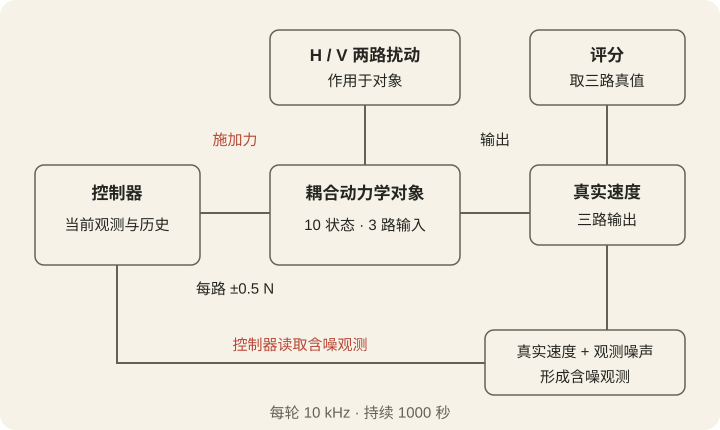
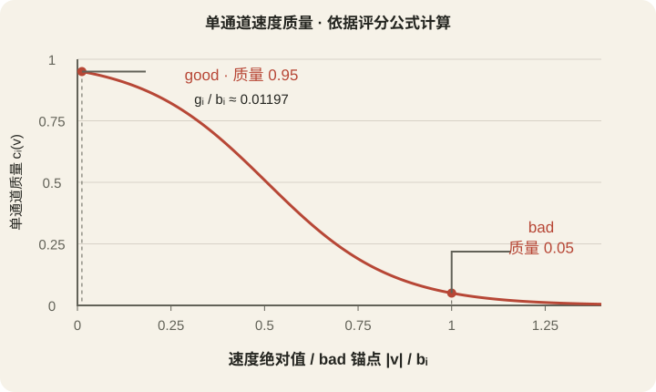

# AVIS3 Arena Plus：让 Agent 开发一个持续工作的控制器

AVIS3 Arena Plus 把一道控制工程任务交给 Agent：面对持续扰动和带噪声的观测，设计能够长期压低系统振动的控制器。Agent 需要理解模型、选择算法、编写程序，并根据测试结果改进方案。正式测评时，提交的控制器在每个采样时刻计算控制力。

Evaluation-1108 于 2026 年 11 月 8 日完成，包含 14 个独立提交、12 个不同模型。每个提交运行同一组 20 个私有场景，共完成 280 轮。当前竞技版本为 avis3-plus-v1。

## 控制器在做什么

对象是一个耦合动力学系统，包含 10 个内部状态、3 路控制输入、3 路速度输出，以及 H、V 两路扰动。耦合意味着某一路施力可能同时影响多个输出，控制器需要兼顾三路响应。

每个时刻，控制器读取当前含噪速度观测，结合自身保存的历史信息，计算三路物理力。每路力限制在 ±0.5 N。控制器可利用公开的名义模型，建立状态估计、预测系统响应，或通过合法观测进行在线辨识。

<picture>
  <source media="(max-width: 680px)" srcset="/ai-frontier/evaluation-1108/figures/control-loop-mobile.svg" width="360" height="680">
  
</picture>

图中连线表示信号关系，文字标明读取与施加的作用。观测噪声会影响控制决策，评分支路使用三路真实速度。

## 从开发到正式测评

开发从阅读任务与公开名义模型开始。Agent 分析系统特点，选择控制策略，再实现为 Python、Rust/C ABI 或声明式矩阵控制器。测试阶段可观察效果、定位不稳定或控制不足的问题，调整参数与算法。开发测试使用独立随机场景。

本次协议最多安排三轮对话，组织者提供的配置为各模型最高可用思考档。最终收齐提交后，组织者依次开展测评。每轮重新创建控制器实例，执行完整的采样、控制和状态推进过程。

采样频率为 10 kHz，即相邻控制步间隔 0.0001 秒。每轮持续 1000 秒，共推进 1000 万步。初始观测用于启动控制；动作施加并完成状态更新后，新的真实速度开始计分。这要求控制器在长时间运行中保持稳定，并持续响应扰动。

## 每轮面对怎样的场景

场景参数在每轮开始时抽取，轮内固定。三对高频共轭模态的频率倍率为 [0.97, 1.03]，阻尼比倍率为 [0.8, 1.2]；三路执行器增益倍率为 [0.9, 1.1]，两对低频模态保持不变。控制器依据公开名义模型设计，也需要适应真实对象与名义参数之间的差异。

H、V 两路扰动幅值每轮分别从 [1, 5] 均匀独立抽取。所有提交的第 i 轮使用相同对象、初态、扰动和噪声，因此可以逐轮比较同一场景下的表现，再观察跨场景稳定性。

## 分数怎样计算

### 先把速度变成单通道质量

速度绝对值越小，质量越高。每个通道设有 good 和 bad 两个速度锚点，基础值分别为：

$$
g_0 = 1.9547922240808726\times10^{-8}\ \mathrm{m/s}
$$

$$
b_0 = 1.6327546630968648\times10^{-6}\ \mathrm{m/s}
$$

每轮按扰动幅值与冻结的名义 H/V 功率标尺，同时缩放两个锚点，得到该轮的 $g_i$ 和 $b_i$。这让不同扰动强度对应各自的评分敏感区。两个锚点同比例变化，$g_i/b_i$ 保持一致。

令 $\sigma(z)=1/(1+e^{-z})$。单通道质量分两步计算：

$$
z_i(v)=\ln(19)\,\frac{g_i+b_i-2|v|}{b_i-g_i}
$$

$$
c_i(v)=\sigma\!\left(\operatorname{clip}(z_i(v),-60,60)\right)
$$

clip 将输入限制在指定区间。速度达到 good 锚点时质量为 0.95，达到 bad 锚点时为 0.05；两者之间平滑过渡，在中点 $(g_i+b_i)/2$ 处质量为 0.5。

<picture>
  <source media="(max-width: 680px)" srcset="/ai-frontier/evaluation-1108/figures/quality-curve-mobile.svg" width="360" height="365">
  
</picture>

横轴使用 $|v|/b_i$，不同场景的同比例锚点缩放对应同一条曲线。零速度的质量约为 0.953283，高于 good 锚点处的 0.95。

### 三路质量共同决定每一步的贡献

每步将三路质量相乘，形成平滑的“同时满足”条件：

$$
q_k=c_1(y_{1,k})\,c_2(y_{2,k})\,c_3(y_{3,k})
$$

例如，三路质量均为 0.9 时，乘积为 0.729；如果第三路降为 0.2，乘积便降到 0.162。这两个数是公式示例，说明即使两路控制良好，一路明显变差也会拉低整体贡献。

### 沿整轮时间累积

每一步的贡献为 $q_k/f_s$，将 1000 万步相加得到一轮积分：

$$
J=\frac{1}{f_s}\sum_{k=1}^{N}q_k
$$

$$
f_s=10000\ \mathrm{Hz},\qquad N=10000000
$$

持续保持较高质量会积累更多分数，短暂的良好响应只贡献对应时段的积分。三路真实速度始终为零时，按公式得到理论上限：

$$
J_{\max}=1000\,c(0)^3
\approx866.2937
$$

冻结记录中的完整上限为 866.2936695331011。评分沿用原始精度，页面数值按展示位数取舍。

## 如何读排行榜

每个提交的最终成绩是 20 轮积分的算术平均，越高越好。排名使用完整精度均值。展开条目后，可结合逐轮积分判断哪些场景更困难，并阅读控制器方案和提交自述。

样本标准差描述 20 轮成绩的离散程度，使用 ddof = 1：

$$
\bar J=\frac{1}{20}\sum_{r=1}^{20}J_r
$$

$$
\operatorname{std}=
\sqrt{\frac{1}{19}\sum_{r=1}^{20}(J_r-\bar J)^2}
$$

平均分概括整体表现，标准差帮助观察场景间起伏。规则故障轮计为 −1，随后继续其余轮次；本次全部 280 轮均完成。

GPT-6 Astra 和 DeepSeek-V4.1-Flash-1017 各有两次独立开发，每次提交分别计算成绩与排名。控制器摘要和完整自述反映提交时的方案与判断，其中的开发测试分数和预测可与本次逐轮结果对照阅读。

## 结合频谱观察控制效果

频谱呈现不同频率上的振动分布，可比较受控真值与同场景无控制基线。速度功率谱通过 Welch 方法估计，再在正频率处换算为位移等效 ASD，单位为 m/√Hz。图中展示 0.01–100 Hz。

查看器提供“20 轮功率平均”和“统一第 1 轮”两种视角。前者将每轮 ASD 平方后等权平均，再开平方：

$$
A_{\mathrm{pool}}(f)=
\sqrt{\frac{1}{20}\sum_{r=1}^{20}A_r(f)^2}
$$

受控曲线和基线使用同一方法汇总。切换到第 1 轮，可在同一场景中观察各控制器的频率响应。读图时同时看通道名称、频率和纵轴刻度，留意改善集中在哪些频段，以及三路输出是否都得到抑制。
