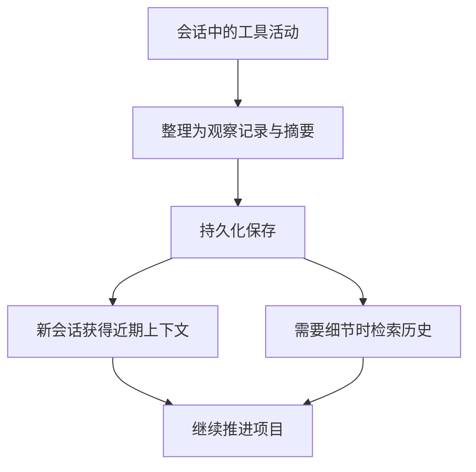

# 给 AI 编程助手补一份项目记忆：聊聊 claude-mem

最近，我给 [claude-mem](https://github.com/thedotmack/claude-mem) 贡献了一项 [PR（#4792）](https://github.com/thedotmack/claude-mem/pull/4792)。这项改动已经随 [v13.40.0 正式发布](https://github.com/thedotmack/claude-mem/releases/tag/v13.40.0)，发布说明中也列出了它。借着这件事，想在这里介绍一下这个项目，给它做一点推广。

如果你经常让 AI 编程助手陪着做一个持续几天、甚至更久的项目，claude-mem 很值得了解。它关心的是开发中一个挺具体的问题：这次会话积累的背景，怎样留给下一次工作继续使用？

## 为什么需要一份项目记忆

一个项目推进久了，会留下很多仅看最终代码不容易看出的信息：某个接口为什么这样设计，哪些方案已经尝试过，某个看似多余的步骤究竟在照顾什么条件。

这些信息经常散落在对话、命令输出和临时判断里。隔几天重新打开一个会话，要继续做事，往往得先把前面的探索再讲一遍。上下文很长时，真正需要的那几条决定也未必容易找出来。

claude-mem 的做法，是在编程助手旁边增加一层可以持久保存、也可以检索的工作记录。它通过宿主工具的 hooks 采集活动，由后台服务整理出观察记录和会话摘要，再在后续会话中提供上下文。项目最直接的入口是 Claude Code，也提供了其他编程工具的接入方式，可以按自己的环境查看[官方安装文档](https://docs.claude-mem.ai/installation)。

对我来说，这个思路最有吸引力的地方，是让一次探索产生的信息有机会被后面的工作重新利用。

## 它怎样把工作接起来

可以先把它的主要流程理解成下面这张图。图里省略了具体宿主与部署配置，只保留“记录、整理、找回、继续工作”的关系。



按照[官方使用说明](https://docs.claude-mem.ai/usage/getting-started)，文件读取、代码修改、命令执行等工具活动会进入采集流程。后台再从中提取关键事实、涉及的文件和活动类型等信息，并生成包含已完成工作与后续步骤的摘要。这些记录可以保存到本地 SQLite 数据库。

这里面有三点值得单独看看。

### 自动整理工作过程

日常开发时，人通常更愿意把精力放在眼前的任务上，未必会在每次调试结束后认真写一份交接。claude-mem 把一部分记录工作放到了后台，让开发过程中的发现能够留下来。

比如，一个任务经过几轮调查才确认了问题所在，期间还排除了两条思路。下一次继续处理时，能够找到这些探索记录，就多了一条恢复背景的路径。这是一个使用场景的例子；实际记录是否充分，仍要看当时采集到了什么，以及摘要保留了哪些信息。

### 先找线索，再取细节

有了历史记录，还需要决定每次带进来多少内容。把所有旧对话都塞进当前会话，阅读和定位反而会变得费力。

claude-mem 的[记忆搜索](https://docs.claude-mem.ai/usage/search-tools)采用分层检索：先用 `search` 找到简短索引，需要前后背景时查看 `timeline`，再用 `get_observations` 取回相关记录的详细内容。这样可以先判断哪些条目值得看，再展开细节。

你可以用自然语言提出类似的问题：“这个项目上次修过什么问题？”“当时为什么采用这套数据格式？”编程助手再借助搜索工具查找历史。对于隔一段时间重新接手的项目，这种入口很实用。

### 能够查看留下了什么

项目还提供 Web Viewer，可以浏览记忆记录，查看观察、会话等内容。它让用户有机会检查记忆层实际保存了什么，而不必只凭助手说“我记得”来判断。入口地址以本地 worker 启动时的输出为准，相关组成可以在[架构说明](https://docs.claude-mem.ai/architecture/overview)中查看。

我比较看重这一点：工具帮助保留背景，人也需要能够回头核对这些背景。

## 先跑一个最小闭环

如果已经在使用支持插件的 Claude Code，可以按照[官方 README](https://github.com/thedotmack/claude-mem/tree/v13.40.0#quick-start)中的方式，在 Claude Code 内执行：

```text
/plugin marketplace add thedotmack/claude-mem
/plugin install claude-mem
```

完成配置后重启 Claude Code。首次启动可能还需要准备运行依赖；如果没有看到预期的记忆上下文，可以按[安装文档](https://docs.claude-mem.ai/installation)检查运行环境与 hooks 状态。

第一次尝试，我建议选一个没有敏感内容、而且确实需要接着做的小任务：

1. 在项目里完成一次小修改，说明修改原因，并跑一遍相关检查。
2. 查看记录或摘要，确认这次工作的关键背景已经留下来。
3. 新开会话，先让助手查找前一次的工作，再请它结合当前文件继续推进。

还可以问一句：“之前已经尝试过哪些方案？请找到相关记忆记录，并核对现在的代码。”这样的试用更容易看出它有没有帮助自己减少重复解释。

不同宿主和版本的依赖、配置方式可能变化，实际操作时以官方文档为准。先把一个小任务接续起来，就能更具体地判断它是否适合自己。

## 哪些时候值得试试

我觉得它尤其适合这些情况：一个仓库长期反复维护；一个问题需要多次会话才能查清；或者工作经常被其他任务打断，回来以后要先恢复思路。只要“把前情重新讲一遍”已经成为固定开销，就有理由试试这种工具。

同时，记忆也需要和当前状态一起看。旧摘要可能遗漏条件，曾经正确的判断也可能已经被新代码改变。长期有效的约定适合写进项目文档，代码事实仍应通过当前文件、Git 记录和测试确认。claude-mem 提供的是一条找回背景的路径。

安装时也要看清自己选择的摘要模型与数据流向：记录可以在本地保存，但模型处理和云同步有各自的配置。摘要会使用模型资源，长期记录也会占用存储。项目提供 [private 标签](https://docs.claude-mem.ai/usage/private-tags)等排除机制；是否使用[云同步](https://docs.claude-mem.ai/cloud-sync)，可以结合自己的项目和设备需求决定。

## 从这里开始

我想推荐 claude-mem，是因为它把跨会话继续工作的麻烦，拆成了一套可以观察、可以检索的工具流程。最近参与贡献，也给了我一个把它介绍给更多人的契机。

如果你正在和编程助手一起维护一个长期项目，不妨先拿一项小任务跑通“留下记录，再接着做”的过程，看看它是否适合自己的工作习惯。

::link-card{title="claude-mem 项目仓库" eyebrow="开源工具 · 跨会话记忆" href="https://github.com/thedotmack/claude-mem"}
从 README、发布记录和官方文档开始了解这个项目。
::

::link-card{title="claude-mem 官方文档" eyebrow="安装 · 使用 · 记忆搜索" href="https://docs.claude-mem.ai/"}
按自己的编程工具选择接入方式，再用一个小任务检查上下文能否顺利延续。
::

*本文发布于 2026 年 10 月 18 日。贡献发布记录以 v13.40.0 为准，功能与安装入口参考项目官方文档；封面为概念插画，不是软件界面截图。*
