# ETF：从原理到配置的入门指南

ETF 把一组资产组织成可以在交易所买卖的基金份额。它降低了投资一个市场的操作难度，也让资产配置变得更容易：用少数几只基金，就能组合美国股票、海外股票、债券和黄金。

理解 ETF，可以沿着三个问题展开：**买到的底层资产是什么，收益从哪里来，这笔投资在整个组合中承担什么作用。** 搞清楚这些问题，再看代码、费率和历史涨幅，判断会清楚得多。

本文先解释机制与分类，再逐一介绍 15 只代表性产品，最后讨论配置、购买和持有。基金资料核验于 **2026-11-14**；历史图统一使用 **2006-10-31 至 2026-10-30** 的近 20 年观察窗口，成立较晚的基金展示其实际上市历史。图表日期与费率核验日期分开标注，便于以后更新。

**阅读导航：** [ETF 的原理](#etf-principles) · [常见种类](#etf-types) · [收益与历史图](#returns-and-history) · [代表产品](#etf-products) · [组合配置](#portfolio-allocation) · [购买与持有](#buying-and-holding) · [数据口径](#data-methodology)

## ETF 是什么，为什么会出现 {#etf-principles}

### 一份基金，持有一组资产

ETF 的全称是 **Exchange-Traded Fund，交易所交易基金**。基金管理人按照既定策略持有股票、债券或其他资产，再把基金分成许多份。投资者持有 ETF 份额，间接享有相应基金资产带来的收益，也承担其价格变化。

例如，想参与美国大型公司的整体表现，可以逐一买入数百家公司的股票，也可以购买追踪标普 500 指数的 ETF。后者把选定成分、按权重配置、处理分红和调整持仓等工作交给基金完成。

这里有两个不同的概念：

| 概念 | 回答的问题 | 例子 |
|---|---|---|
| ETF | 基金份额如何组织和交易？ | 在交易所挂牌，投资者盘中买卖 |
| 指数投资 | 资产依据什么规则配置？ | 按标普 500、沪深 300 等指数配置 |

ETF 可以跟踪指数，也可以采用主动管理策略。指数基金则既有 ETF 形式，也有通过基金平台申购赎回的场外形式。中文市场常用的“交易型开放式指数基金”主要描述指数型 ETF；放到全球市场，ETF 的范围更广。

指数本身是一套选取资产、确定权重并计算整体表现的规则和统计结果。成分会按规则调整，跟踪它的基金也会相应维护持仓。下文提到的“敞口”，可以理解为资金对某类资产涨跌的参与程度：一个简单组合有 60% 投入股票，就有大约 60% 的股票敞口。

### 它解决了什么问题

自己复制一个市场，既需要足够的资金，也需要持续维护：成分股会变，权重会变，股息需要处理，数百笔交易还会产生费用。传统场外基金已经解决了集合投资的问题，但通常按每天计算的净值成交，交易方式与股票不同。

ETF 在集合投资的基础上加入交易所交易机制。普通投资者可以用一笔订单获得一组资产的敞口，机构也可以借此快速调整组合。1993 年成立的 SPY 是美国首只 ETF，以标普 500 为投资对象；随后 ETF 逐步扩展到债券、国际市场和其他资产。

ETF 常见的优势来自下面几种机制：

| 优势 | 实际意义 |
|---|---|
| 降低操作门槛 | 一次买入即可持有一组资产，无需逐项交易和维护 |
| 容易实现分散 | 宽基基金可覆盖许多企业、行业和国家，降低单家公司出问题的影响 |
| 费用可以很低 | 大规模、规则化管理和较低换手率，使不少宽基 ETF 的年费率降至很低水平 |
| 交易方便 | 在开放交易的时段提交订单，可以使用限价单等工具 |
| 持仓与规则便于查阅 | 指数方法、基金报告和持仓披露帮助投资者理解自己买了什么；披露频率依产品而异 |
| 配置容易组合 | 股票、债券、黄金等产品可以分别承担增长、流动性或分散风险的作用 |

这些优势依赖具体产品。覆盖单一行业的 ETF 仍可能高度集中，复杂策略的费用也可能较高。**“ETF”说明了产品形式；资产和策略决定了大部分投资风险。**

### 价格为什么通常接近净值

ETF 有两个值得区分的价格：**净值**反映每份基金资产扣除负债后的价值，**市场价格**反映投资者此刻愿意以什么价格成交。

假设基金资产扣除负债后值 1,000 万元，共有 100 万份，单位净值就是 10 元。如果交易所报价为 10.10 元，就存在约 1% 的溢价。

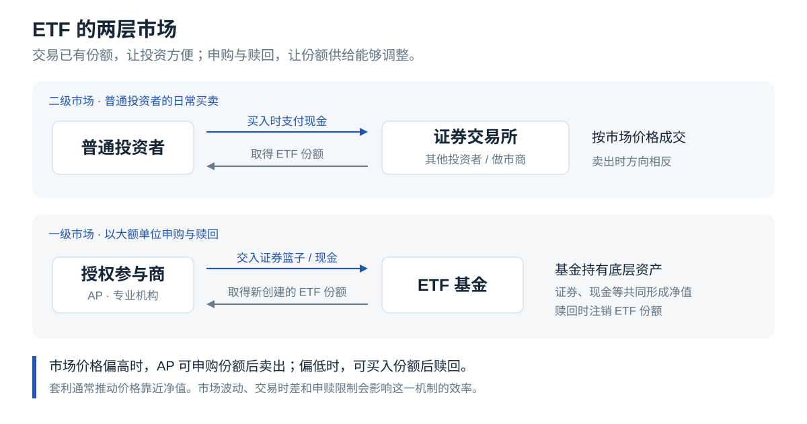

普通投资者主要在二级市场交易已有份额。一级市场则允许符合条件的参与者以大额单位申购和赎回。以美国 ETF 为例，授权参与商（Authorized Participant，AP）可以用约定的证券篮子、现金或两者组合换取新份额，也可以反向交回份额、取得对应资产。

当 ETF 明显偏贵时，机构可以申购份额后在交易所卖出；明显偏便宜时，可以买入份额后赎回。这种套利活动通常使价格靠近净值。跨市场时差、交易成本、底层资产流动性和申赎限制都会影响套利效率，因此溢价和折价仍会出现。

## 常见 ETF 可以怎样分类 {#etf-types}

识别 ETF，最实用的顺序是：**先看资产类别，再看投资范围，最后看筛选规则与交易策略。** 下表中的类别可以交叉，例如一只基金可以同时属于“日本股票”“高股息”和“被动管理”。

| 类别 | 主要投向或做法 | 典型特点 | 本文中的例子 |
|---|---|---|---|
| 股票宽基 | 一个市场中较广泛的企业 | 适合作为股票配置的基础，风险随整体股市变化 | VOO、VTI、VT、VXUS、510300 |
| 国家或区域股票 | 日本、欧洲、新兴市场等 | 可以调整地域权重，同时承担当地市场和汇率变化 | EWJ |
| 风格与因子 | 按股息、质量、价值、小盘等条件筛选 | 与市场整体表现可能长期不同 | SCHD |
| 行业与主题 | 半导体、能源、医疗、机器人等 | 投资逻辑集中，行业周期和估值变化影响更大 | 本文不展开单一主题产品 |
| 债券 | 国债、投资级公司债、高收益债等 | 需要同时看信用质量、久期、币种；不同债券的风险差别很大 | BND、VGSH、VGIT、TLT |
| 超短债与现金管理 | 很短期限的国库券等 | 价格通常平稳，收入随短期利率调整 | SGOV |
| 房地产证券 | 上市房地产投资信托（REITs）、房地产企业 | 收益受租金、融资成本、物业估值等影响，仍有股票市场波动 | 本文不展开具体产品 |
| 商品与实物资产 | 实物黄金或商品期货 | 实物与期货结构差异很大；期货基金还涉及展期损益 | GLD |
| 期权收益策略 | 持有股票并卖出看涨期权等 | 权利金可增加现金分配，但可能让出部分上涨空间，仍会承担下跌 | 本文不展开具体产品 |
| 杠杆与反向 | 通过衍生品追求某个日收益倍数 | 多数产品按日重置，长期结果受涨跌路径影响 | 适合单独学习其机制 |

主动管理与被动管理是另一条分类轴。主动 ETF 由管理人判断持仓；被动 ETF 以跟踪特定指数为目标。两者都需要检查真实持仓、费用和策略约束。

QQQ 经常被归入“科技 ETF”，实际跟踪的是纳斯达克 100：在纳斯达克上市的大型非金融公司，其中还有消费、医疗等行业。它的筛选范围与纯信息技术行业指数有明显区别。

## 先读懂收益，再看历史图 {#returns-and-history}

### 总回报由价格变化和现金分配共同构成

以 100 元买入一份 ETF，一段时间后价格升到 110 元，同时收到 3 元分配。忽略交易费用和税收，持有期总回报为：

$$
R = \frac{p_1-p_0+d}{p_0}
  = \frac{110-100+3}{100}
  = 13\%.
$$

其中，$p_0$ 是买入价格，$p_1$ 是期末价格，$d$ 是这段期间收到的每份现金分配。这一简式没有考虑分配到账后的再投资；跨多年比较时，通常采用包含分配再投资的总回报。

**分红会把基金内的一部分价值转到投资者的现金账户。** 假设除息前一份基金价值 100 元，派发 3 元，在其他条件不变时，除息后约为“97 元基金份额 + 3 元现金”。市场继续交易后，实际价格还会受到行情影响。单独挑选高分红产品，无法直接推导出更高的总收益。

股票 ETF 的收益主要来自企业盈利、股息，以及市场愿意给予的估值变化。债券 ETF 的收益主要来自利息与债券价格变化。实物黄金没有企业利润或票息，其收益主要来自金价变化。

### 几个经常被混用的“收益率”

| 指标 | 说明什么 | 阅读时的重点 |
|---|---|---|
| 价格涨跌幅 | 基金份额价格变了多少 | 单独使用时会漏掉现金分配；要处理份额拆分 |
| 总回报 | 价格变化与分配合起来的结果 | 比较长期表现时，通常采用分配再投资口径 |
| 年化回报 | 将一个区间的复合增长折算成每年同样增长的比例 | 每年的实际涨跌可能差别很大 |
| 过去 12 个月分配率 | 过去一年分配金额相对当前价格的比例 | 属于回看指标，会受价格和特别分配影响 |
| 30 日 SEC 收益率 | 按标准方法，将最近 30 天的净投资收入年化 | 便于比较债券基金的当前收入水平；未来利率和价格仍会变化 |
| 到期收益率 | 依据债券价格和约定现金流计算的收益指标 | 基金会换券，费用、违约、再投资和卖出时点都会影响实际结果 |
| 回撤 | 当前累计价值比此前最高点低了多少 | 更接近持有人“从账户高点亏下去多少”的体验 |

分配型基金会把现金支付给持有人；累积型份额会在基金内部继续投资。长期积累阶段，分配型也可以通过券商的股息再投资计划（DRIP）继续买入。是否产生税款，要看账户与适用税制，自动再投资本身不会消除税务事项。

### 历史图的统一读法

下文每只产品都有一张图，横轴统一放在近 20 年窗口内：

- **蓝线**：以首个有效交易日为 100，用复权收盘价近似表示分配再投资后的累计价值。
- **灰色虚线**：同样从 100 开始，只看经过拆分调整的价格变化。
- **红色区域**：蓝线相对区间内此前最高点的回撤。
- **浅灰空白**：这只 ETF 当时还没有可用的上市交易记录，没有用指数回测补齐。

累计价值为 200，表示起点资金大约翻了一倍；回撤为 -30%，表示从此前最高点跌去了约三成。各图纵轴独立缩放，比较波动大小时请看刻度与回撤数值。

**不同成立时间对应不同市场环境，图上的“区间年化”不能直接排成投资优先顺序。** 例如 VOO 的记录从 2010 年开始，跳过了 2008 年金融危机；VTI 在本窗口中完整经历了那次下跌。两者起点不同，会明显影响回报和最大回撤统计。

数据来自 Yahoo Finance，基金层面费用已体现在历史价格中；个人交易费用、分配预扣税、汇兑成本与通胀没有另行计入。美元产品按美元展示，510300 按人民币展示。完整算法、起止日期和数值见[附录](#data-methodology)。

## 代表性 ETF：逐一认识 {#etf-products}

### 产品速查

下表的美国产品费用采用官方披露的年度费用率。510300 列示管理费与托管费，口径与美国基金的总费用率有所不同；完整持有成本还包括交易、汇兑、税收等项目。

| 代码     | 核心投资对象           |                  年度费用 | 常见分配安排   | 配置中的主要用途        |
| ------ | ---------------- | --------------------: | -------- | --------------- |
| VOO    | 标普 500，美国大型股     |                 0.03% | 季度       | 美国股票基础配置        |
| VTI    | 美国全市场股票          |                 0.03% | 季度       | 覆盖大、中、小型企业      |
| VT     | 全球发达与新兴市场股票      |                 0.06% | 季度       | 用一只基金完成全球股票配置   |
| VXUS   | 美国以外的全球股票        |                 0.05% | 季度       | 为美国股票持仓补充地域分散   |
| QQQ    | 纳斯达克 100         |                 0.18% | 季度       | 增加大型成长类企业权重     |
| QQQM   | 纳斯达克 100         |                 0.15% | 季度       | 以较低费率持有同一指数     |
| SCHD   | 美国股息与质量筛选策略      |                 0.06% | 季度       | 调整股票风格，获取股息现金流  |
| BND    | 美国综合投资级债券        |                 0.03% | 月度       | 中等久期的债券基础配置     |
| SGOV   | 0–3 个月美国国库券      |                 0.09% | 月度       | 短期美元资金管理        |
| VGSH   | 1–3 年美国国债        |                 0.03% | 月度       | 短久期美元国债配置       |
| VGIT   | 3–10 年美国国债       |                 0.03% | 月度       | 中等久期、以美国国债为主的配置 |
| TLT    | 剩余期限超过 20 年的美国国债 |                 0.15% | 月度       | 长久期利率敞口         |
| GLD    | 实物黄金             |                 0.40% | 通常没有现金分配 | 黄金敞口与资产分散       |
| EWJ    | 日本股票             |                 0.49% | 半年度      | 单独调整日本市场权重      |
| 510300 | 沪深 300，中国 A 股    | 0.15% 管理费 + 0.05% 托管费 | 按公告分配    | 人民币 A 股宽基配置     |

分配频率表示通常的安排，分配金额取决于基金实际收入与政策。GLD 的法律结构为实物黄金信托，市场上常将其与黄金 ETF 一起讨论；它与普通股票基金的结构有区别。

**代码校正：** 素材讨论的美国综合债券基金对应 **BND**。NBD 曾是 Nuveen Build America Bond Opportunity Fund 的代码，属于封闭式基金，已于 2018-11-19 并入 NBB。下面按素材中的资产类别介绍 BND。

### VOO：美国大型企业的整体表现

VOO 是 Vanguard S&P 500 ETF，跟踪标普 500 指数。指数覆盖约 500 家美国大型企业，按自由流通市值加权，并有盈利能力、流动性等纳入条件。大公司权重更高，因此“持有约 500 家公司”与“每家公司平均分配资金”有很大区别。

**收益方式。** 企业增长、股息与估值变化共同决定回报。股息通常按季度分配，长期收益中的较大部分可能体现为份额价格上涨。美国大型企业有大量海外业务，但其海外收入与直接持有海外股票仍是两种不同的地域敞口。

**配置参考。** 可以作为美国股票部分的主要持仓，再用 VXUS 增加美国以外的股票。若已经采用 VTI，额外加入 VOO 主要会提高美国大型股的占比。VOO、IVV、SPY 都提供标普 500 敞口，选择时可以在费率、价差和交易便利之间比较；通常无需同时持有多只同类产品。

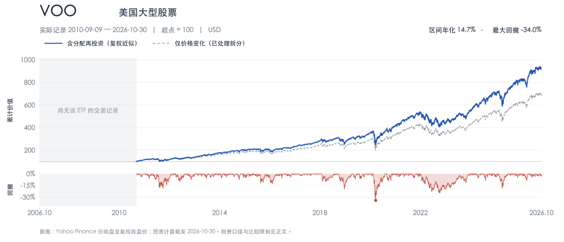

**读图。** VOO 在 2010 年成立，图中最大回撤约 34.0%，发生于 2020 年。这个记录没有覆盖 2008 年，美国大型股的长期风险需要结合更早的市场历史理解。

### VTI：把美国中小型企业也纳入组合

VTI 覆盖美国大型、中型、小型及微型上市公司。它同样采用市值加权，所以大型公司仍占很大比重。增加数千家公司后，组合的尾部覆盖更完整，但整体走势依然常与 VOO 接近。

2026 年 7 月，VTI 的正式名称增加了 Morningstar，现为 **Vanguard Morningstar Total Stock Market ETF**，基准更名为 **Morningstar US Total Market Index**，此前称 CRSP US Total Market Index。官方说明此次更名没有改变指数编制方法、投资策略或基金代码，旧资料中的名称仍可与当前产品对应。

**收益方式。** 来自美国企业的股价变化和股息，中小型公司的表现也会贡献收益。它提供了更广泛的美国市场覆盖，但不会因为公司数量多，就自动获得更高收益或更低回撤。

**配置参考。** 适合希望持有整个美国股票市场的人。VTI 与 VXUS 可以分别管理美国和海外权重，也可以作为后文三基金组合中的两只股票基金。VOO 和 VTI 通常选择其中一只作为美国股票基础，再根据明确目的调整。

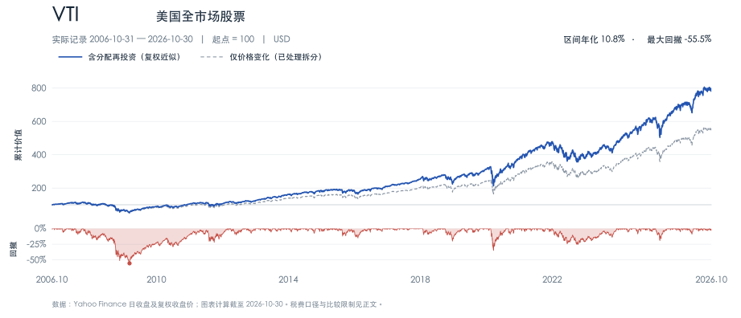

**读图。** 本窗口从 2006 年开始，VTI 经历了 2007—2009 年约 55.5% 的最大回撤。宽基分散能够削弱个股风险，整体经济与市场下跌仍会影响几乎整个组合。

### VT：用一只基金持有全球股票

VT 是 Vanguard Total World Stock ETF，跟踪 FTSE Global All Cap Index，覆盖美国、其他发达市场和新兴市场的大、中、小盘股票。国家权重随全球股票市值变化，美国通常占据较大份额。它的地域分散来自市场覆盖，国家之间并没有平均分配。

**收益方式。** 来自全球企业的股价变化和股息。以美元衡量时，海外股票还受到当地货币对美元变化的影响。全球分散减少了对某一国家长期领先的依赖，也意味着在某一市场特别强势时，VT 可能落后于该市场基金。

**配置参考。** 可以承担长期组合中的全部股票部分；债券和短期资金另行安排。若用 VT 后再加入 VOO、VTI 或 VXUS，就会主动改变美国与海外的权重。愿意接受全球市值权重、希望减少维护工作的人，通常更容易使用这种结构。

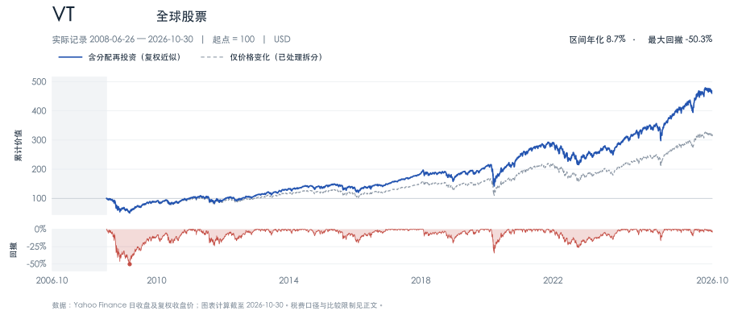

**读图。** VT 在 2008 年 6 月才开始交易，仍经历了约 50.3% 的区间最大回撤。全球股票在金融危机中可能一起下跌，地域分散的作用需要放在更长的市场轮动中观察。

### VXUS：补齐美国以外的股票

VXUS 是 Vanguard Total International Stock ETF，跟踪 FTSE Global All Cap ex US Index，覆盖美国以外的发达和新兴市场股票。它包括日本、欧洲、加拿大，也包括中国、印度、巴西等市场。这里的“International”以美国为参照。

**收益方式。** 海外企业的利润、股息和估值变化形成股票回报，汇率变化影响美元计价结果。与美国大型成长股相比，不同国家的行业结构、分红习惯和估值水平存在差异，收益节奏也可能不同。

**配置参考。** 常与 VTI 或 VOO 搭配。如果希望接近全球市值结构，可以查看 VT 或全球指数当前的美国占比，再确定美国与海外股票的比例；使用固定比例也可以，但需要认识到这是主动的地域选择。已经持有 VT 时，再加入 VXUS 会提高美国以外市场的权重。

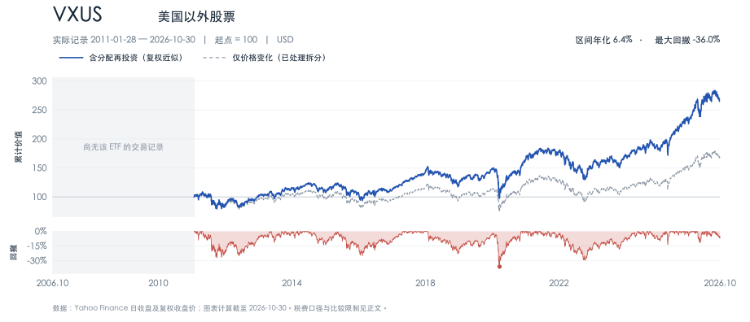

**读图。** 蓝线与灰线之间的差距说明，长期分红对国际股票的回报有实质贡献。图中年化较低，反映的是这段特定历史，不能据此认定国际分散在未来没有价值。

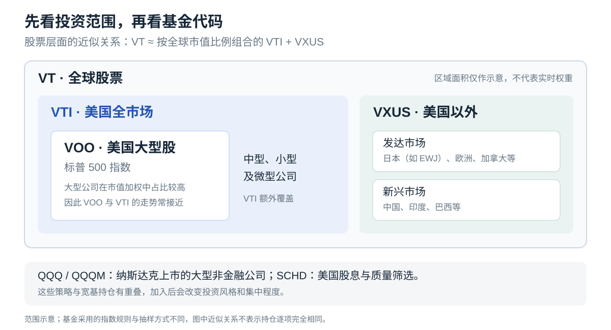

VTI + VXUS 可以近似实现 VT 的全球股票覆盖。由于基准规则、国家分类、成分抽样和权重维护方式不同，这种组合与 VT 的持仓和收益会有细小差异。

### QQQ：在股票组合中提高大型成长类企业的权重

QQQ 跟踪纳斯达克 100 指数，主要投资在纳斯达克上市的大型非金融公司，采用经过约束的市值加权。它长期偏重科技与成长类企业，也包括部分非美国公司。纳斯达克 100 与覆盖更广的纳斯达克综合指数是不同的指数。

**收益方式。** 主要来自企业盈利增长与估值变化，股息通常占比较小。当市场愿意为未来增长支付更高价格时，价格上涨可能很快；增长预期下降或估值压缩时，跌幅也可能较大。

**配置参考。** 可以在已有宽基基础上，增加有意识的成长风格配置。例如，从股票部分中划出 10%—20% 给 QQQ，其余保持宽基，这只是表达配置思路的示例。已有 VOO 或 VTI 时，QQQ 往往会继续增加组合中同一批大型公司的权重，应该合并计算。QQQ 的当前年度费率为 **0.18%**，旧资料中的 0.20% 已发生变化。

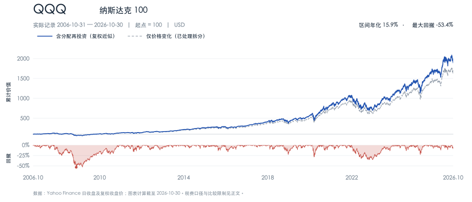

**读图。** QQQ 在这段历史中增长很强，也曾出现约 53.4% 的最大回撤；2022 年总回报约为 -32.6%。图从 2006 年开始，2000 年前后的互联网泡沫周期还在窗口之外，完整的长期风险历史比这张图更长。

### QQQM：相同指数下，更偏向长期持有的选择

QQQM 于 2020 年成立，也跟踪纳斯达克 100，年度费率为 **0.15%**。与 QQQ 的主要区别在产品成本、交易生态与成立历史，底层投资方向非常接近。QQQ 的交易和期权市场通常更成熟，QQQM 的较低费率更容易体现为长期持有中的成本优势。

**收益方式。** 与 QQQ 相同，来自纳斯达克 100 成分公司的价格变化和股息。低费率减少了部分长期成本，并没有改变该指数的集中程度和市场风险。

**配置参考。** 计划长期买入持有、没有特定交易需求时，可在 QQQ 与 QQQM 之间比较。两者相差 0.03 个百分点，在持仓价值固定为 1 万美元的简化假设下，年费用差约 3 美元。切换已有仓位时，还要考虑卖出税负、买卖价差和佣金，避免只看这一个数字。

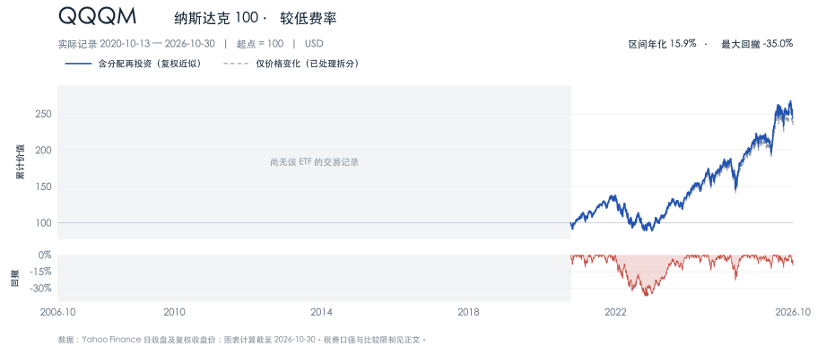

**读图。** QQQM 的实际记录从 2020 年开始，最大回撤约 35.0%。观察更早的同类策略表现可以参考 QQQ；本图保留空白，避免把另一只基金的历史算到 QQQM 名下。

### SCHD：把股息记录与财务质量一起考虑

SCHD 是 Schwab U.S. Dividend Equity ETF，跟踪 Dow Jones U.S. Dividend 100 Index。筛选会考虑持续派息记录，并综合股息率、股息增长、净资产收益率、现金流与负债等指标。最终持仓偏向符合这些条件的约 100 家美国公司。

**收益方式。** 股息与股价变化共同贡献收益，分配通常按季度进行。高分配率可能来自较高派息，也可能来自股价下跌；两种情况对持有人的意义不同。企业分红减少、财务恶化或行业走弱时，基金仍会受到影响。

**配置参考。** 可以替代股票仓位中的一部分，用来增加股息、质量和价值倾向。需要现金流时，可以比较“领取分红”和“按计划卖出少量份额”的税后效果。SCHD 应计入股票仓位；如果同时保留债券，债券承担的利率和信用敞口仍需单独规划。

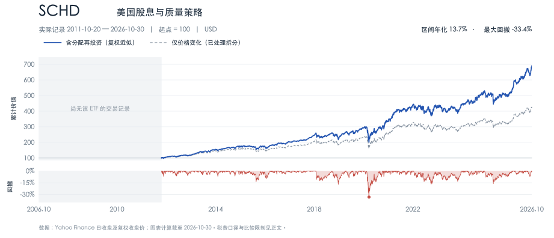

**读图。** 分红再投资使蓝线与价格线逐渐拉开，但 2020 年仍出现约 33.4% 的最大回撤。SCHD 在 2024 年进行过 1 拆 3，图表已调整拆分，避免把份额单位变化误读为大跌。

### BND：美国综合债券市场的一组基础持仓

BND 是 Vanguard Total Bond Market ETF，跟踪 Bloomberg U.S. Aggregate Float Adjusted Index。它覆盖美元计价的投资级应税债券，包括美国国债、政府相关债券、公司债和抵押贷款支持证券等；整体属于中等久期。其范围不包含所有债券类别，例如高收益债和通胀保值债就不在同一覆盖框架内。

**收益方式。** 债券利息形成月度分配，债券市场价格变化影响基金净值。市场利率上升，存量债券价格往往下跌；公司信用利差扩大也会压低相关债券价格。信用利差可以理解为投资者持有公司债，相对类似期限国债所要求的额外收益率。基金持续换券，投资者的持有期限与其中每张债券的到期期限不同。

**配置参考。** 可以作为长期美元组合的债券基础。希望减少公司信用风险时，可以比较以美国国债为主的 VGIT；希望降低短期净值波动时，可以比较 VGSH 或 SGOV。将来主要支出为人民币时，还需要将美元兑人民币的变化一起考虑。

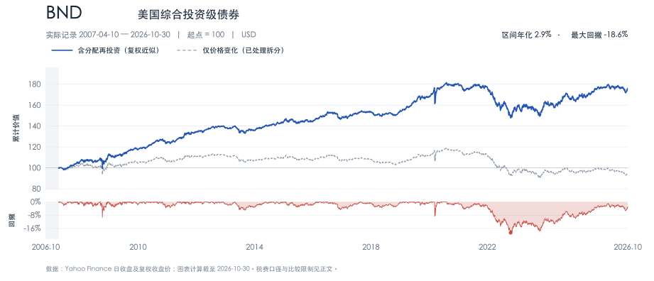

**读图。** 只看价格线，会漏掉多年收到的利息。即使纳入分配，BND 在 2020—2022 年仍出现约 18.6% 的最大回撤，2022 年总回报约 -13.1%。中等久期债券也会经历持续亏损。

### SGOV：管理近期不用的美元

SGOV 投资剩余期限为 0—3 个月的美国国库券，期限很短，价格对利率变化通常不敏感。它滚动持有短期证券，因此收益会较快跟随美元短期利率变化。基金成立于 2020 年，费用率为 0.09%。

**收益方式。** 国库券通常以折价发行，到期按面值偿还，利息收益体现为折价逐渐收敛。基金将相关收入累计后按月分配。除息时，份额价格会相应下调，所以价格图经常表现为很小的锯齿；长期收入主要体现在分配和再投资中。

**配置参考。** 可用于已有美元资金的短期安排，例如即将支出的美元、等待执行的定期买入资金。若资金最终用于人民币生活开支，美元汇率波动可能大于短债价格波动。真正需要随时取用的现金，还应考虑卖出、结算和提现所需时间。SGOV 属于基金产品，银行存款保障并不适用。

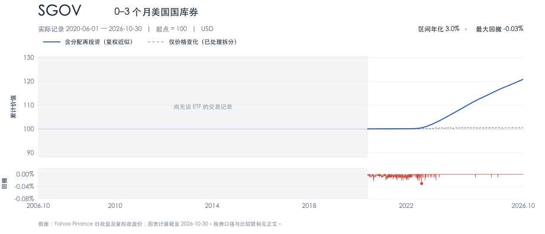

**读图。** 蓝线在接近零利率的时期增长很慢，短期利率提高后斜率明显增加。样本中的日收盘最大回撤约 0.03%，这个数值只描述过去的美元价格记录，盘中成交价差、税费和汇率另有影响。

### VGSH：比国库券更长一些的短期国债

VGSH 主要投资 1—3 年期美国国债，跟踪 Bloomberg U.S. Treasury 1–3 Year Bond Index。它通常有约 2 年量级的久期，利率敏感度高于 SGOV，低于中长期国债基金。

**收益方式。** 月度利息分配与债券价格变化共同构成回报。利率上升时会产生一定价格压力，利率下降时则可能获得价格收益。随着旧债换成新债，组合收入也会逐渐改变。

**配置参考。** 可用于希望降低长期债券波动、同时接受一定净值变化的美元债券部分。对用途确定、时间很近的支出，需要继续比较现金、到期日匹配的短债与超短债基金。即便债券期限较短，ETF 自身仍持续存续，没有给投资者承诺某一天按固定金额兑付。

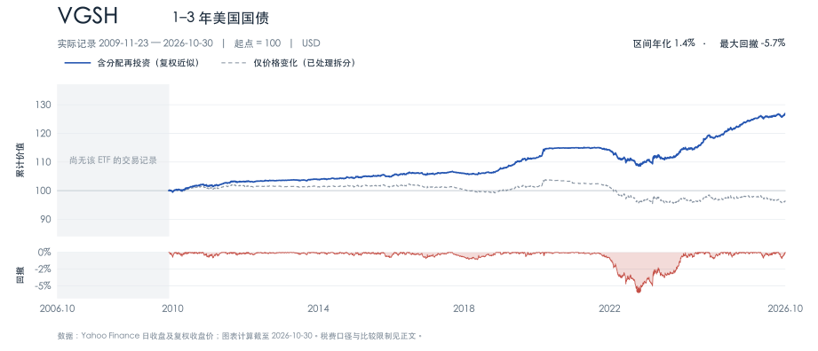

**读图。** 2022 年总回报约 -3.9%，区间最大回撤约 5.7%。短久期降低了冲击幅度，但仍会留下可见的亏损区间。

### VGIT：中期美国国债的利率敞口

VGIT 跟踪 Bloomberg U.S. Treasury 3–10 Year Bond Index，主要持有 3—10 年期美国国债。与 BND 相比，其底层债券类别更集中于美国国债；与 VGSH 相比，久期更长，对市场利率变化更敏感。

**收益方式。** 票息提供月度收入，债券价格随相应期限的市场收益率变化。经济疲弱、市场利率下降的时期可能获得价格上涨；通胀压力或利率上升则可能带来损失。

**配置参考。** 适合希望在美元债券部分采用中等久期、减少公司信用利差影响的组合。可以与股票搭配，也可以与 SGOV 或 VGSH 分工：短期部分满足流动性，中期部分承受更多利率变化。债券的抗跌效果取决于当时的经济环境。

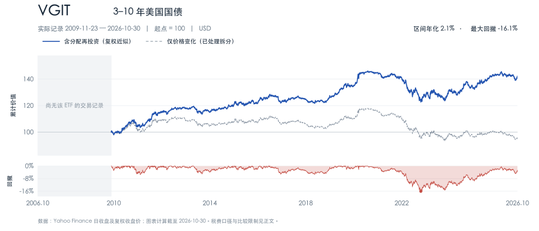

**读图。** VGIT 在 2022 年下跌约 10.5%，区间最大回撤约 16.1%。与 VGSH 对照，可以直观看到期限结构对债券波动的影响。

### TLT：很长的国债，显著的利率敏感度

TLT 持有剩余期限超过 20 年的美国国债。尽管底层发行人为美国政府，长久期仍会带来较大的市场价格波动。官方页面在 2026-11-12 披露的有效久期约为 **14.75 年**，这一数值会变化。

**收益方式。** 来自月度利息与长期国债价格变化。决定价格的关键是相应长期债券的市场收益率；美联储调整短期政策利率后，长期利率未必同幅度、同方向变化。

**配置参考。** 更适合明确需要长久期敞口，或有长期负债匹配需求的人。若希望在组合中增加它，需要先接受其可能出现接近股票量级的回撤。把 TLT 放进“短期备用金”部分，会造成资金用途与价格波动之间的明显错配。

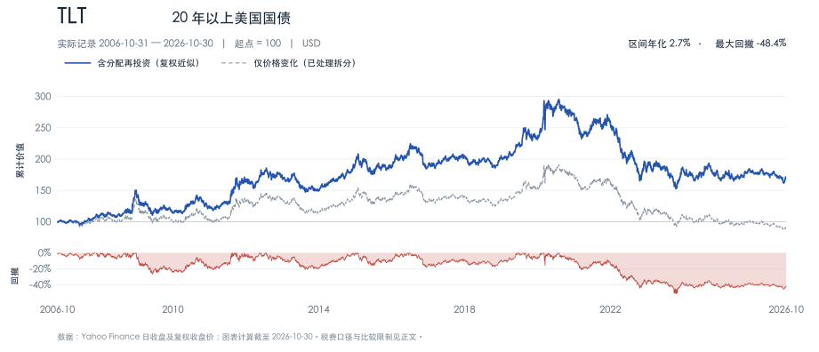

**读图。** TLT 从 2020 年高点到 2023 年低点的总回报回撤约 48.4%，2022 年单年约跌 31.2%。信用质量与利率敏感度是两项需要分别判断的属性。

### GLD：用证券账户持有黄金敞口

GLD，即 SPDR Gold Shares，通过持有实物黄金，使份额表现接近金价变化扣除费用后的结果。它节省了个人购买、保管和交易实物金条的操作，但仍有基金费用；每份对应的黄金数量会因支付费用而逐渐减少。

**收益方式。** 黄金没有票息，也没有企业利润，GLD 通常不发放现金分配。持有人的收益主要来自黄金市场价格变动。实际利率、货币变化、避险需求与投资需求都会影响金价，黄金价格也可能多年低迷。

**配置参考。** 可以在股票和债券之外增加一类不同的资产。若希望纳入，可用总资产中的一个有限比例，例如 5%—10%，观察它对整个组合的作用，再按事先确定的规则维护。需要持续现金收入时，要同时考虑黄金缺乏内生现金流这一特点。

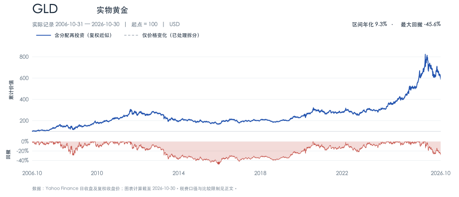

**读图。** 没有现金分配，蓝线与灰线基本重合。2011—2015 年间约 45.6% 的最大回撤说明，黄金的分散价值与它自身的价格稳定性需要分开理解。

### EWJ：单独观察和配置日本市场

EWJ 是 iShares MSCI Japan ETF，跟踪 MSCI Japan Index，投资日本股票，在美国上市并以美元交易。组合覆盖日本多个行业，适合了解国家型 ETF 的作用。其费率为 0.49%，明显高于本文中的几只美国或全球宽基。

**收益方式。** 日本股票的本币价格变化、股息，以及日元相对美元的变化共同影响美元回报。EWJ 没有把日元汇率风险系统性对冲掉；日元走弱时，可能抵消一部分日本股市的本币上涨。

**配置参考。** 可以用于主动提高日本股票权重，或作为学习区域市场的样本。VT 和 VXUS 已经包含日本股票，加入 EWJ 后应该把现有持仓一并计算。若需要直接在日本市场买入当地 ETF，还要重新比较指数覆盖、交易币种、税收和券商权限。

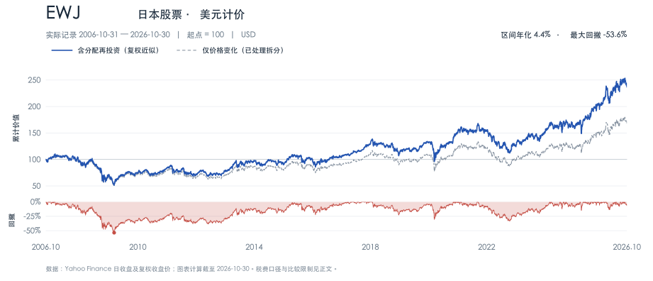

**读图。** 这张图展示美元投资者的历史体验。将其与日元计价的日经 225 或 TOPIX 直接对照，会同时混入指数选择和汇率两种差异。

### 510300：人民币账户中的 A 股宽基

510300 是华泰柏瑞沪深 300 ETF，在上海证券交易所上市，跟踪沪深 300 指数，覆盖沪深市场中规模较大、流动性较好的 300 只证券。基金于 2012 年成立、5 月 28 日上市，人民币计价。管理费与托管费分别为每年 0.15% 和 0.05%。

**收益方式。** 来自中国 A 股成分公司的价格变化与分红。基金现金分配以公告为准，持有期比较应将分配计入。它提供 A 股大盘股敞口，对港股、海外上市中国公司和 A 股中小盘的覆盖与其他中国股票指数不同。

**配置参考。** 可以承担人民币投资组合中的 A 股基础配置。已经持有 VT 或 VXUS 时，其中虽有中国股票，覆盖范围和权重与单独配置沪深 300 仍有差别。也应把现有工作收入、房产和其他境内股票持仓一起考虑，避免只从证券账户局部判断地域分散。

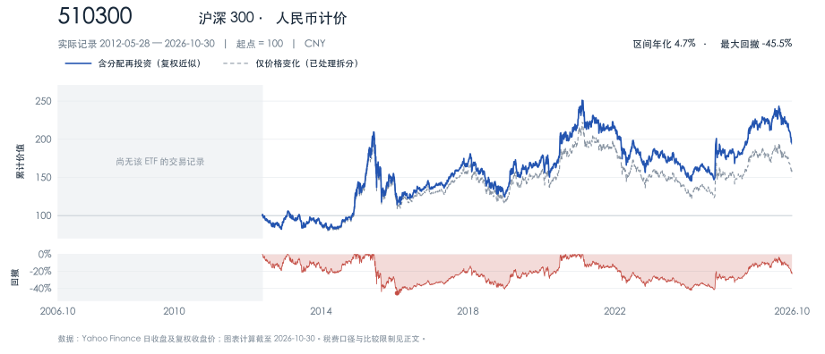

**读图。** 图中最大回撤约 45.5%，谷底出现在 2016 年初。本图按人民币统计，与美元图比较前需要统一币种；2012 年上市之前的灰区没有用沪深 300 指数历史补齐。

## 怎样把这些 ETF 组成一个组合 {#portfolio-allocation}

### 先确定钱的用途与使用时间

同一只 ETF，对十多年后的退休支出和半年后的房租，意义完全不同。配置之前，可以先把资金分成几类：

| 资金用途 | 主要目标 | 配置时优先考虑 |
|---|---|---|
| 随时可能用到的应急资金 | 随时可取、金额稳定 | 支出币种、账户可用性、取款速度 |
| 一两年内确定要用的钱 | 控制到用款时的金额波动 | 现金、短期高质量资产、到期日匹配 |
| 数年后的目标资金 | 在增长与金额确定性之间平衡 | 股票比例、债券久期、接近用款时的调整 |
| 十年以上的长期积累 | 承担适量波动，争取长期增长 | 宽基股票、地域分散、持续投入与维护 |

期限只是一个起点。收入稳定性、已有负债、家庭支出、对账面亏损的实际反应，同样会影响可承受的股票比例。某笔钱即使计划持有十年，中间仍可能经历很深的下跌。

**资金最终用什么货币支出，应该与“股票还是债券”一起考虑。** 为近期人民币支出准备的资金，如果换成美元持有 SGOV，就额外加入了汇率变量；美元价格平稳，并不能使人民币金额同时稳定。

### 股票部分，先选覆盖方式，再决定是否倾斜

可以从两种简单结构中选一种：

- **VT：** 按全球市值结构持有股票，地域权重随基金调整。
- **VTI + VXUS：** 把美国与美国以外分开持有，自行决定地域比例；偏好美国大型股时，可在理解覆盖差异后使用 VOO。

有了基础结构，再考虑是否确实需要 QQQM、SCHD、EWJ 等倾向。加入这些产品，需要能够说清楚希望提高什么资产或风格的权重。

重叠可以用一个简单算式理解。假设某家公司在基金 A 中占 6%，在基金 B 中占 9%；组合中各持有 A、B 的 50%，那么这家公司在总组合中的权重为：

$$
50\%\times6\%+50\%\times9\%=7.5\%.
$$

如果还直接持有这家公司股票，实际集中度要继续相加。基金数量增加以后，真正需要检查的是底层公司、国家、行业和风险来源的权重。

### 债券部分，久期决定了多少利率波动

债券的信用质量说明发行人按约还本付息的能力。**久期**则描述债券价格对市场收益率变化的敏感程度，两者需要分别看。

对较小、近似平行的收益率变化，可以用下面的关系作粗略估计：

$$
\frac{\Delta p}{p}\approx-D\,\Delta y.
$$

其中，$D$ 为有效久期，$\Delta y$ 是收益率变化，以小数表示。假设久期为 6 年，市场收益率提高 1 个百分点，即 $\Delta y=0.01$，价格的一阶估计变化约为 -6%。这个估计没有加入期间利息、凸性、信用利差和持仓调整。

因此，SGOV、VGSH、VGIT、TLT 虽然都以美国国债类资产为主，价格体验会很不一样。BND 还加入公司债和抵押贷款支持证券等类别。确定债券配置时，可以依次考虑支出币种、用途与期限，再看信用质量、久期和收益率。

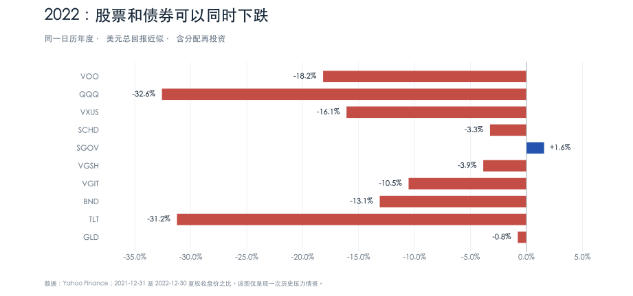

2022 年提供了一个直观例子：VOO 与 BND 都下跌，长久期的 TLT 跌幅也很大。股票和债券的相关关系会随通胀、增长与利率环境变化，组合中加入债券仍需要说明期望它承担哪一种作用。上述数据均按同一日历年度计算；QQQ 约 -32.6% 的结果也可与发行人的历史说明交叉核对。

### 几种便于比较的组合结构

下面统一以长期、美元计价的可投资资产为 100%，应急资金另行准备。比例用于说明结构差异，重点在于每一部分的任务。

| 结构 | 示例比例 | 结构特点 |
|---|---|---|
| 极简全球配置 | VT 80% + BND 20% | 两只基金，股票占比较高；地域维护工作较少 |
| 自行管理地域 | VTI 48% + VXUS 32% + BND 20% | 股票占 80%，其中美国与海外为 60∶40；地域比例由自己设定 |
| 兼顾增长与流动性 | VT 60% + BND 30% + SGOV 10% | 股票占 60%，同时保留中期债券和短期美元资金 |
| 降低股票比重 | VT 40% + VGIT 40% + SGOV 20% | 股票占 40%，对中期利率仍有明显敞口 |
| 加入黄金 | VT 60% + BND 30% + GLD 10% | 增加黄金的收益来源，接受其自身价格波动 |

这些结构仍可调整。例如，决定增加 10% 的 QQQM，可以从原有股票部分划出相应比例，同时重新计算美国与行业集中度。若直接在原有 100% 组合之外加仓，组合的实际权重已经发生改变。

可以用一个算术情景检验自己对股票比例的感受：假设股票跌 40%、中期债券跌 10%、短期部分收益为 0，忽略汇率，那么“VT 80% + BND 20%”约跌 34%；“VT 60% + BND 30% + SGOV 10%”约跌 27%。这是统一假设下的计算，用来理解权重的影响；实际下跌幅度和相关关系会不同。

与其只问“能不能接受跌 20%”，还可以把比例换成金额：若 10 万美元组合降到 6.6 万美元，生活支出是否受到影响？会不会迫于用款需求卖出？能否继续按计划投入？这些问题通常比给自己贴上“积极”或“稳健”的标签更有帮助。

### 定投、再投资与复利如何衔接

每月收入逐步到账时，可以固定投入一定金额。它将投资与现金流连接起来，减少临时择时的次数。若一笔资金已经全部到位，把它分批投入则是在主动延后入市：这样可能缓解买在高点的心理压力，也会产生等待期间的机会成本。

定投本身不会改变 ETF 的底层资产，也不会消除股票市场的长期下跌。它的价值主要在于执行方式与资金来源相匹配。长期持有则需要投资逻辑仍然成立、资金用途没有变化，并且仓位适合承受波动。

分配到账后，可以继续买入原基金，也可以投入低于目标比例的资产。后者能同时完成再投资与再平衡。需要现金支出时，也可以选择领取分配，或按计划卖出部分份额。

复利来自收益继续参与后续投资。举例说，每月月底投入 500 美元，假设**有效年回报率固定为 7%**，月回报率采用 $(1.07)^{1/12}-1$，持续 20 年，累计投入 12 万美元，期末约为 **25.38 万美元**。这里的 7% 是演示假设，真实 ETF 的回报会逐年波动。明确“有效年率”与“年率除以 12”两种计算约定，也能避免不同复利计算器给出不同结果时产生误解。

### 再平衡，让仓位回到计划

假设目标为股票 60%、债券 40%，股票连续上涨后变成 75% 与 25%。此时组合承担的股票风险已经高于原计划，可以通过新增资金、分配现金或卖出一部分涨幅较大的资产恢复比例。

维护规则可以很简单：每年固定检查一次，或者在某个大类偏离目标超过 5 个百分点时处理。优先用新增资金调整，往往可以减少卖出交易和相关税费。再平衡的主要作用是维护风险结构，它无法保证提高每个时期的收益。

## 购买和持有时要看什么 {#buying-and-holding}

### 先确认买的是哪一个产品

搜索代码后，应核对基金全名、发行人、交易所、底层指数与产品类型。SPX 是标普 500 指数的常用代码，VOO、IVV、SPY 才是对应的可交易基金；SPX 期权属于另一类产品。

注册地、上市地、交易币种与投资地区也要分开看。EWJ 在美国上市、以美元交易，底层主要是日本股票；用美元交易不会自动移除日元相关风险。同一基金在不同市场挂牌时，也可能有不同交易代码，可结合全名和国际证券识别码（ISIN）核对。查看按欧洲统一基金规则运作的 UCITS 产品时，还应分清分配型与累积型，以及是否有明确的汇率对冲安排。官方产品页中的注册地、份额类别与交易所列表，比单看一个代码提供的信息更完整。

每份价格也与投资估值不同。100 份、每份 10 元的基金，与 10 份、每份 100 元的基金，持仓金额都是 1,000 元。比较“贵不贵”，要看底层资产的估值、基金费用和成交折溢价；份额拆分本身只改变份数与每份价格。

### 成本要从净结果看

| 成本或指标 | 怎样检查 |
|---|---|
| 年度费用率 | 看最新产品页面与招募文件；通常从基金资产中逐日计提，无需另付一张年费账单 |
| 跟踪差异 | 比较基金总回报与同口径指数总回报，观察实际落后或超出的幅度 |
| 跟踪误差 | 看上述收益差异随时间波动有多大，反映跟踪是否稳定 |
| 买卖价差 | 同一时刻的买价与卖价之间有距离，成交会产生隐含成本 |
| 佣金与最低收费 | 小额、高频买入时，最低佣金可能比管理费差异更重要 |
| 汇兑与资金转移费用 | 换汇价差、入金与出金费用会影响跨市场投资的实际结果 |
| 税收 | 股息、基金分配、卖出收益和持有结构可能有不同处理 |

比较跟踪效果时，要统一币种、时间区间，以及价格指数、税前总回报指数、税后总回报指数等口径。基金内部预扣税、抽样、现金头寸、证券借贷收入和交易费用，都可能造成差异。

**历史净值和价格已经反映基金内部费用，计算持有回报时无需再把管理费重复减一次。** 同理，已经采用实测跟踪差异估算成本时，也应避免把已包含的费用再次相加。

费用率可换成金额帮助判断：假设平均持仓价值为 1 万美元，0.03% 的年费率对应约 3 美元，0.40% 对应约 40 美元。费率按资产价值计提，实际金额会随持仓变化；底层资产和策略不同的基金，还需结合它们提供的作用比较。

### 下单时，同时看价差与折溢价

买卖价差回答“现在买入再卖出，要跨过多大的报价距离”；折溢价回答“成交价格与每份基金资产价值相差多少”。这两项可以同时存在。

可以按这个顺序操作：

1. 确认账户有对应市场权限、可用资金和正确币种，核对佣金与最低收费。
2. 在产品正常交易时段查看买卖报价、基金规模、交易情况与底层资产流动性。
3. 比较当前价格与净值或可靠估值，阅读近期暂停申购、分红、清盘等公告。
4. 对价格敏感的订单使用限价单，设定愿意接受的最高买价或最低卖价；同时接受可能暂时无法成交的结果。
5. 成交后核对数量、价格和费用，并确认分配接收方式及结算后的资金安排。

交易所成交量只是流动性的一部分。ETF 还依赖做市、申赎能力与底层资产的可交易性。市场开盘、收盘或底层市场未开放时，报价条件可能变化，跨境 ETF 尤其需要留意。

跨境产品显示的净值可能属于前一个海外交易日，盘中参考净值也可能使用滞后价格。看到溢价数字时，需要先确认估值的时间与方法。通过合格境内机构投资者（QDII）机制投资海外的境内 ETF，还可能因额度或申赎限制出现持续溢价，相关机制在基金招募文件中有具体说明。

例如净值为 100，却以 110 买入，随后净值保持 100 而溢价消失，价格回到 100，亏损约为 $100/110-1\approx-9.1\%$。这部分损失来自买入溢价的回落，底层指数在这个假设中没有下跌。

### 交易制度与资金到账，要按市场分别理解

| 场景 | 操作上需要知道的事 |
|---|---|
| 中国境内普通股票 ETF | 通常实施 T+1 回转限制，当日买入的份额需下一交易日才能卖出；竞价买入一般以 100 份或其整数倍申报 |
| 境内部分债券、黄金、跨境和货币 ETF | 符合相应规则的品种可当日回转；交易前查对应产品规则 |
| 美国上市 ETF | 标准证券结算周期为 T+1；能否当日买卖、如何使用未结算资金，还取决于账户类型及券商规则 |
| 券商提供的碎股或定期投资 | 最低金额、可选产品和订单类型因平台而异，可能只支持特定执行方式 |

这里有两个不同的“T+1”：**回转限制**描述买入后何时可以再次卖出，**结算周期**描述成交后何时完成证券和资金交割。成交、资金可用于继续交易、资金可提现，也可能发生在不同时间。

买入境外产品时，还要确认账户资格、资金转移规则与实际可买的产品范围。境内账户中的 QDII 产品与直接持有美国 ETF，在费率、额度、交易时间和跟踪效果上可能不同。

### 汇率会改变本币投资结果

假设美元计价的 ETF 上涨 8%，同一期间一美元可兑换的人民币减少 5%，人民币口径回报为：

$$
R_\mathrm{CNY}
=(1+R_\mathrm{USD})(1+R_\mathrm{FX})-1
=1.08\times0.95-1
=2.6\%.
$$

这里的 $R_\mathrm{FX}$ 指美元兑人民币汇率的变化，即每美元对应人民币数量的变化。这个公式说明，美元资产的上涨与人民币账户的盈利幅度之间还隔着汇率。EWJ、VXUS 等基金还可能同时涉及底层市场货币相对美元的变化。

### 跨境税费，抓住几个与产品选择直接相关的点

税收应按实际税务居民身份、基金注册地和收入性质核对。对美国税务非居民而言，美国来源的普通股息通常适用 30% 预扣税，符合税收协定条件时可能降低；W-8BEN 用于证明相应身份和申请适用的协定待遇。

债券 ETF 的分配还可能包含符合条件的 interest-related dividends 等类别，部分分配在满足条件时可免于相关预扣。应查看发行人的年度税务分类以及券商实际处理，不能把所有债券基金分配统一看成一种税率。

基金层面扣税、投资者收到分配时的预扣，以及税务居民所在地的申报，是不同层次。券商已经扣过一项税，仍需要检查所在地的申报和抵免规则。再投资分红也应保留成本与税务记录。

长期持有美国注册产品时，还应确认美国遗产税下的资产所在地认定。IRS 对部分美国非居民、非公民遗产规定，美国境内资产超过 6 万美元时会涉及申报门槛；申报义务与最终应纳税额需要分别判断，并考虑适用协定与资产结构。这也是比较不同注册地基金时值得检查的一项实际差异。

### 避免把收益目标写进产品名称里

“高股息”“低波动”“价值”“创新”等名称描述筛选规则或投资方向，最终仍需看持仓和策略。低波动股票基金仍属于股票，高分配率也可能同时伴随净值下跌。使用卖出看涨期权策略的基金，现金分配中可能包含期权收益等成分，代价通常涉及一部分上涨空间。

杠杆 ETF 则需要理解按日重置。假设某指数第一天涨 10%，第二天跌约 9.09%，两天后回到原点。一个理想化的每日两倍产品，在忽略费用时会变成：

$$
100\times(1+2\times10\%)\times(1-2\times9.09\%)\approx98.18.
$$

因此，多天的结果与“指数长期回报乘二”之间可能有明显差异；持续单边趋势与反复震荡也会产生不同效果。把这类产品放入长期组合前，应单独研究重置规则、融资成本与衍生品结构。

### 持有期间，维护一份简短记录

买入前写下：跟踪什么资产、为什么加入、目标权重、预计持有期限、分配如何处理、何时检查比例。以后复核时，再看产品策略、费用、规模、跟踪效果，以及自身资金用途是否发生变化。

ETF 也可能清盘或合并。即使清盘通常会按程序变现并分配资产，投资者仍可能遇到被动卖出、税款和重新配置的问题。关注产品存续与公告，能减少这类操作上的意外。

一份便于长期执行的投资计划，通常可以用几句话写清楚。例如：“长期资金采用全球股票与高质量债券；近期支出保留同币种流动资产；每月投入；每年检查目标比例；新增产品必须说明它改变了哪一项资产权重。” 有了这样的记录，下一次市场上涨或下跌时，就有具体依据可以回看。

## 附录：历史数据与计算口径 {#data-methodology}

### 数据范围

历史数据取自 Yahoo Finance 的 `chart` 数据接口，字段为日频 `close` 与 `adjclose`，下载核验日期为 **2026-11-14**。请求窗口覆盖 2006 年 10 月末至 2026 年 10 月末，统一截止到最近完整月份的最后交易日 **2026-10-30**。`close` 已处理拆分，`adjclose` 进一步调整适用的现金分配。

查询参数为 `period1=1162166400`、`period2=1793491200`、`interval=1d`、`events=div,splits`、`includeAdjustedClose=true`。可从[VOO 的数据接口示例][yahoo-api]查看字段结构，再将路径中的代码替换为表中代码；510300 在该数据源中的代码为 `510300.SS`。历史数据和复权系数可能随数据商修订而变化，各 SVG 图内也保存了来源与计算摘要。

基金成立日期与首次上市交易日期可能不同。本图采用有效交易记录：例如 VOO 的基金成立日为 2010-09-07，图从 2010-09-09 开始；SGOV 成立于 2020-05-26，图从 2020-06-01 开始。510300 数据源中出现了上市前的零散观察值，本次按官方上市日期 **2012-05-28** 截断，未把它们当作场内交易价格。

### 计算方法

设 $a_t$ 为复权收盘价，$p_t$ 为经过拆分调整的收盘价，$t_0$ 为实际样本起点，$T$ 为样本终点。两条累计价值曲线分别为：

$$
w_t=100\frac{a_t}{a_{t_0}},
\qquad
q_t=100\frac{p_t}{p_{t_0}}.
$$

其中，$w_t$ 用作分配再投资总回报的近似，$q_t$ 表示单纯价格变化。数据商采用分配调整因子，基金官方总回报还可能使用净值、不同再投资时点与计算细节，因此两者可能有小幅差异。

图中的回撤为：

$$
d_t=\frac{w_t}{\max_{t_0\le u\le t}w_u}-1.
$$

最大回撤取样本内 $d_t$ 的最小值。它依据日收盘价计算，盘中更深的跌幅没有计入；样本开始前的市场高点也没有计入。尤其是 VT，2008 年 6 月起点已经处于金融危机过程中。

若实际样本长度为 $n$ 年，采用实际天数除以 365.25，则区间年化回报为：

$$
r_\mathrm{ann}=\left(\frac{a_T}{a_{t_0}}\right)^{1/n}-1.
$$

2022 年横向比较采用 2021-12-31 与 2022-12-30 的复权收盘价计算，所有入图产品均有完整该年度记录。历史图与附表使用一次性买入、分配再投资的假设，没有加入定投现金流。美元产品保持美元口径，510300 保持人民币口径。

### 数值索引

全部终点均为 **2026-10-30**。下表保留各基金自己的实际起点，顺序按产品介绍排列。由于起点和币种存在差异，这是一张读图索引，不宜用其中的年化数字直接比较优劣。

| ETF | 图中实际起点 | 累计总回报 | 区间年化 | 最大回撤 | 最大回撤谷底 |
|---|---|---:|---:|---:|---|
| VOO | 2010-09-09 | 812.8% | 14.7% | -34.0% | 2020-03-23 |
| VTI | 2006-10-31 | 681.4% | 10.8% | -55.5% | 2009-03-09 |
| VT | 2008-06-26 | 359.7% | 8.7% | -50.3% | 2009-03-09 |
| VXUS | 2011-01-28 | 164.9% | 6.4% | -36.0% | 2020-03-23 |
| QQQ | 2006-10-31 | 1797.4% | 15.9% | -53.4% | 2008-11-20 |
| QQQM | 2020-10-13 | 143.7% | 15.9% | -35.0% | 2022-11-03 |
| SCHD | 2011-10-20 | 590.8% | 13.7% | -33.4% | 2020-03-23 |
| BND | 2007-04-10 | 76.0% | 2.9% | -18.6% | 2022-10-20 |
| SGOV | 2020-06-01 | 20.9% | 3.0% | -0.03% | 2022-08-23 |
| VGSH | 2009-11-23 | 27.0% | 1.4% | -5.7% | 2022-10-20 |
| VGIT | 2009-11-23 | 42.2% | 2.1% | -16.1% | 2022-10-20 |
| TLT | 2006-10-31 | 71.5% | 2.7% | -48.4% | 2023-10-19 |
| GLD | 2006-10-31 | 490.6% | 9.3% | -45.6% | 2015-12-17 |
| EWJ | 2006-10-31 | 137.2% | 4.4% | -53.6% | 2009-03-09 |
| 510300（人民币） | 2012-05-28 | 94.3% | 4.7% | -45.5% | 2016-01-28 |

### 后续更新时的重点

费率、基准名称、分配政策与交易规则可能变化，可从速查表链接回到官方产品页。涉及美国税务的说明以 IRS 和发行人的年度税务资料为核对入口，境内交易规则以上交所及具体产品公告为入口。更新历史图时，应同时更新截止日期、附表和文中读图数字，并继续区分基金实际历史、指数历史与模拟回测。

[sec-etf]: https://www.investor.gov/introduction-investing/general-resources/news-alerts/alerts-bulletins/investor-bulletins-24
[ici-etf]: https://www.ici.org/faqs/faqs_etfs
[spy]: https://www.ssga.com/us/en/individual/capabilities/spdr-core-equity-etfs/spy-sp-500
[voo]: https://advisors.vanguard.com/investments/products/voo/vanguard-sp-500-etf
[vti]: https://advisors.vanguard.com/investments/products/vti/vanguard-total-stock-market-etf
[vti-rename]: https://www.vanguardsouthamerica.com/en/home/news/name-changes-for-vanguard-equity-index-funds-and-crsp-morningstar-benchmarks
[vt]: https://www.vanguardsouthamerica.com/en/product/etf/equity/3141/vanguard-total-world-stock-etf
[vxus]: https://www.vanguardsouthamerica.com/en/product/etf/equity/3369/vanguard-total-international-stock-etf
[qqq]: https://www.invesco.com/us/en/financial-products/etfs/invesco-qqq-trust-series-1.html
[qqqm]: https://www.invesco.com/us/en/financial-products/etfs/invesco-nasdaq-100-etf.html
[qqq-compare]: https://www.invesco.com/us/en/insights/building-versatile-portfolios-qqq-innovation-suite.html
[qqq-2022]: https://www.invesco.com/qqq-etf/en/innovation/understanding-qqqs-performance-through-market-cycles.html
[schd]: https://www.schwabassetmanagement.com/products/schd
[schd-method]: https://www.spglobal.com/spdji/en/education/article/reflecting-on-15-years-with-15-facts-the-dow-jones-us-dividend-100-index/
[bnd]: https://advisors.vanguard.com/investments/products/bnd/vanguard-total-bond-market-etf
[sgov]: https://www.ishares.com/us/products/314116/ishares-0-3-month-treasury-bond-etf
[vgsh]: https://advisors.vanguard.com/investments/products/vgsh/vanguard-short-term-treasury-etf
[vgit]: https://advisors.vanguard.com/investments/products/vgit/vanguard-intermediate-term-treasury-etf
[tlt]: https://www.ishares.com/us/products/239454/ishares-20-year-treasury-bond-etf
[gld]: https://www.ssga.com/us/en/individual/etfs/spdr-gold-shares-gld
[ewj]: https://www.ishares.com/us/products/239665/ishares-msci-japan-etf
[cn300]: https://www.sse.com.cn/disclosure/fund/announcement/c/new/2024-11-22/510300_20241122_7N07.pdf
[cn300-fee]: https://www.sse.com.cn/disclosure/fund/announcement/c/new/2024-11-20/510300_20241120_FOBE.pdf
[nbd]: https://www.sec.gov/Archives/edgar/data/1478888/000089180419000201/ncsr.htm
[sp500]: https://www.spglobal.com/spdji/en/indices/equity/sp-500/
[nasdaq100]: https://indexes.nasdaq.com/Index/Overview/NDX
[reinvest]: https://investor.vanguard.com/investor-resources-education/online-trading/reinvest-dividends
[dca]: https://investor.vanguard.com/investor-resources-education/online-trading/dollar-cost-averaging-vs-lump-sum
[sse-faq]: https://www.sse.com.cn/assortment/fund/etf/question/
[settlement]: https://www.sec.gov/exams/educationhelpguidesfaqs/t1-faq
[qdii]: https://www.sse.com.cn/disclosure/fund/announcement/c/new/2025-04-16/513220_20250416_QUFF.pdf
[nra-income]: https://www.irs.gov/individuals/international-taxpayers/federal-income-tax-withholding-and-reporting-on-other-kinds-of-us-source-income-paid-to-nonresident-aliens
[w8ben]: https://www.irs.gov/individuals/international-taxpayers/claiming-tax-treaty-benefits
[qii]: https://www.ishares.com/us/literature/tax-information/2025-ishares-qualified-interest-income-summary-stamped.pdf
[estate]: https://www.irs.gov/individuals/international-taxpayers/some-nonresidents-with-us-assets-must-file-estate-tax-returns
[leveraged]: https://www.investor.gov/introduction-investing/general-resources/news-alerts/alerts-bulletins/investor-alerts/sec
[liquidation]: https://www.investor.gov/introduction-investing/general-resources/news-alerts/alerts-bulletins/investor-bulletins/investor-bulletin-fund-liquidation
[ucits]: https://www.vanguard.co.uk/professional/product/etf/equity/9505/vanguard-ftse-all-world-ucits-etf-usd-distributing
[yahoo-adjusted]: https://in.help.yahoo.com/kb/adjusted-close-sln28256.html
[yahoo-api]: https://query1.finance.yahoo.com/v8/finance/chart/VOO?period1=1162166400&period2=1793491200&interval=1d&events=div%2Csplits&includeAdjustedClose=true
