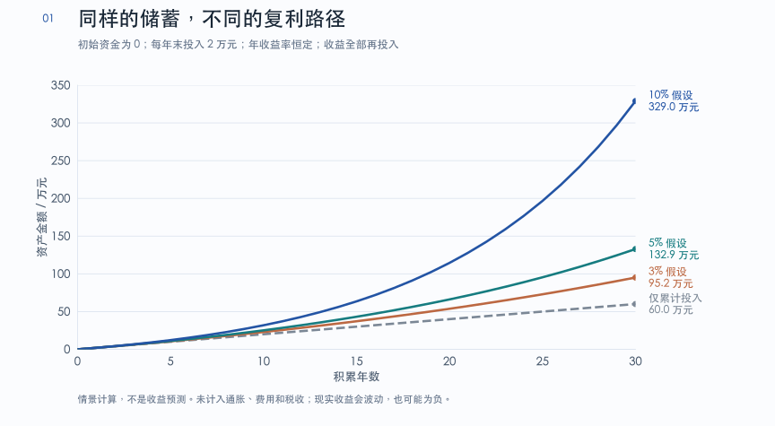
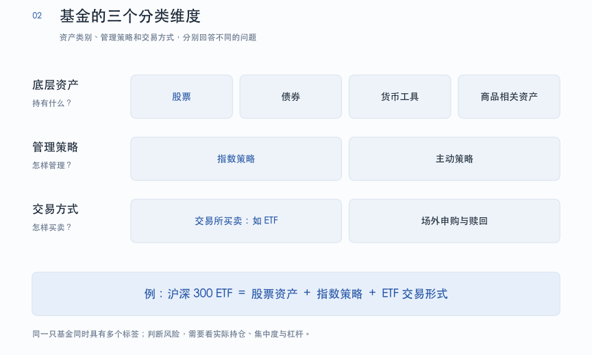
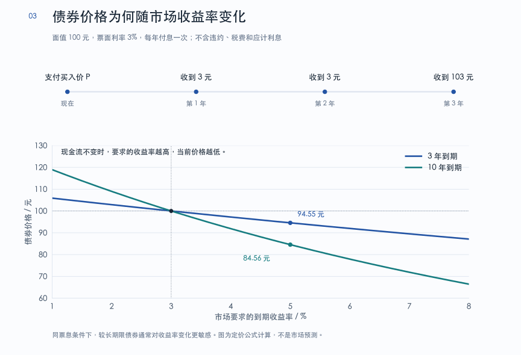
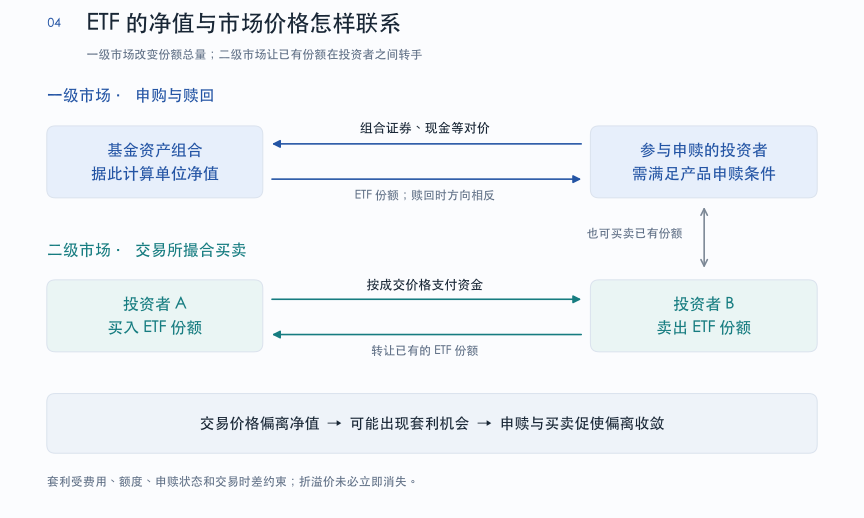

# 投资与理财：一个开始

投资与理财要回答的，是收入如何转化为积累，积累如何支持未来的生活，以及在这个过程中可以承担多大的不确定性。理解这些问题，才有依据判断一项产品是否适合自己。

这份笔记从原始积累讲起，再解释收益、风险、股票、债券和基金之间的关系，最后讨论如何把这些知识落实为家庭财务管理和投资决策。

## 01 为什么要进行投资和理财

### 从劳动收入到长期资产积累

对刚开始工作的人来说，财富积累通常来自工资结余。手上只有几万元时，即使获得一定投资收益，绝对金额也很有限；遇到一次市场回调，还可能亏掉几个月的储蓄。因此，提高专业能力、增加收入、控制不必要的支出，往往比寻找更高收益率更能改变早期的财务状况。

但收入增加并不会自动变成财富增加。收入不断增长、消费也同步增长，仍然可能没有积累。理财的起点，是让收入与支出之间留下可持续的结余，再根据用途，把结余转化为应急储备、特定目标资金和长期投资。

随着积累增加，资产收益在家庭财务中的作用才会逐渐扩大。劳动收入通常依赖持续工作；资产收入可以来自利息、分红、租金，也可以通过出售部分增值资产实现。建立适合自己的资产组合，有助于降低生活对单一工资来源的依赖，为职业调整、家庭照护和退休留下空间。

这里需要区分**资产增值**与**可支配现金流**。股票价格上涨属于资产价值变化，只有分红或卖出后才有现金可以使用；出租房收到租金，也还要支付维修、空置和融资等成本。评价财富能否支持生活，要看扣除成本后的现金流与可持续提款能力。

### 用复利模型理解原始积累

复利指收益继续参与后续投资。假设初始投入为 $A_0$，每年末新增投入为 $s$，每年的收益率恒为 $r$，收益全部再投入，那么 $n$ 年后的资产为：

$$
A_n=A_0(1+r)^n+s\frac{(1+r)^n-1}{r}.
$$

第一项是初始本金的增长，第二项是历年新增投入及其增长。当收益率为零时，公式退化为 $A_n=A_0+ns$。这个模型把三个重要因素放在一起：**能持续投入多少钱、资产取得怎样的回报，以及能够积累多久**。

假设一个人税后年收入为 8 万元，年支出为 6 万元，每年末投入 2 万元，初始本金为零。为了展示复利作用，先使用恒定年收益率 10% 的简化情景，可以得到三个观察财富积累的刻度：

| 观察刻度 | 在假设下对应的资产规模 | 首次达到门槛的年末 | 含义 |
| --- | --- | --- | --- |
| 按 10% 计算的年度收益，相当于每年新增投入 2 万元 | 20 万元 | 第 8 年，约 22.9 万元 | 资产收益开始具有与新增储蓄相近的量级 |
| 按 10% 计算的年度收益，相当于当前年支出 6 万元 | 60 万元 | 第 15 年，约 63.5 万元 | 平均收益的量级已接近生活支出，但仍不能据此退休 |
| 首年按资产的 4% 提款，金额为 6 万元 | 150 万元 | 第 23 年，约 159.1 万元 | 得到一个提款情景下的目标规模，需要进一步检验 |

在上述情景中，第 23 年累计投入为 46 万元，其余约 113.1 万元来自模型中的投资增长。若把收益率假设改为 5%，相同投入在第 23 年只有约 82.9 万元。长期结果对收益率假设十分敏感，因此，不能直接把 10% 当作个人财务规划的确定输入。

*图 1：复利情景比较。曲线由公式计算，未计入通胀、费用与税收；现实中的收益路径会波动。*

这个模型也解释了为什么早期提高储蓄额很重要。假设本金只有 2 万元，多取得 1 个百分点的年收益，增加的收益仅为 200 元；如果通过提高收入或调整支出，每年多结余 1 万元，影响会大得多。资产规模扩大后，收益率和费用差异的作用才更加显著。

较早获得的家庭支持，也可能通过减少高息负债、支持教育或增加长期投资本金，改善未来的财务状况。不过，支持的用途和家庭自身的承受能力同样重要；时间优势无法补救不合理的投资或过高的负债。

### 预期收益能够覆盖开支，不等于已经财务独立

年均收益与每年的实际收益并不相同。资产组合可能在某些年份上涨，在另一些年份大幅下跌。如果需要持续提款，下跌期间为了生活出售资产，会减少后续参与反弹的本金。即使长期平均收益相近，收益发生的顺序不同，提款结果也可能不同，这称为**收益顺序风险**。

常见的 **4% 提款规则**，通常指退休第一年提取初始组合价值的 4%，以后根据通胀调整提款金额，用于讨论约 30 年退休期内的资产可持续性。它与“每年都提取当年余额的 4%”是不同的提款方式，也不表示资产每年稳定产生 4% 的收益。

这一经验来自特定历史市场与资产组合的研究。退休年限、资产配置、估值、通胀、税费和支出调整能力都会影响结果。对希望提早退休、提款期可能超过 30 年的人，更不能只做一次“年支出除以 4%”的运算就得出结论。此外，今天每年 6 万元的生活支出，经过多年通胀后，通常不能继续按 6 万元名义金额估计。

这三个刻度适合帮助观察进展。真正判断资产是否足够，需要把未来支出、养老金等其他收入、风险承受能力和不利市场情景放在一起评估。

### 工作、学习与投资如何分配精力

职业能力是年轻人重要的人力资本。掌握专业技能、建立信誉、学习与人协作，都可能提高未来收入。职业早期，合理增加这方面的投入，往往具有很高的价值。

与此同时，家庭的安全感需要多个支撑。行业景气、雇主状况和个人健康都会变化，单靠一份高薪工作难以覆盖所有风险。持续储蓄、保留流动资金、建立必要保障和发展可迁移的能力，可以共同提高应对变化的能力。

在决定是否为工作投入额外时间时，一个有用的判断是：**这份投入能否形成长期能力、合理回报或自己认可的成就？** 只围绕短期内部评价反复消耗精力，可能挤压学习、健康和家庭生活。工作与投资都应放回生活目标之中衡量。

投资也需要这种取舍。没有必要参与每一轮行情，更没有必要用短期收益证明自己。对长期积累更有帮助的，是保持正结余，理解自己持有的资产，把可能严重损害生活的风险控制在可承受范围内，并持续执行合理的计划。

## 02 投资与理财的基本概念

### 理财、投资与投机

**理财**涵盖收入、支出、负债、保障、储蓄和投资等安排，关注资金能否满足不同阶段的生活需要。**投资**是其中的一部分，指投入资源，在承担不确定性的同时争取未来回报。

**投机**通常更依赖对短期价格变化的判断。投资与投机之间没有仅凭产品名称就能划出的界限：买股票可以基于经营分析，也可以只是追逐涨幅；买基金同样可能是在追热点。关键是收益逻辑、持有期限、风险来源和决策依据是否清楚。

“保护本金”适合作为风险管理原则，但应落实为具体约束：防止诈骗、过度集中、过高杠杆，以及在急需用钱时被迫出售资产。承担市场风险，就必须接受可能出现亏损；把任何亏损都理解为不能发生，会与长期持有风险资产相矛盾。

比较收益率时，也必须比较投入期限、承担的风险、使用的杠杆和费用。一个人在高集中度组合中取得很高收益，并不能证明这种组合适合另一个家庭。

### 收益率：先统一计算口径

投资收益包括价格变化，也包括持有期间收到的分红、利息等现金收入。对一笔没有追加投入、没有中途取款、现金分配暂不再投资的投资，可以写出持有期总收益率：

$$
R=\frac{V_1-V_0+D-K}{V_0}.
$$

其中，$V_0$ 为期初投入金额，包含已支付的买入费用；$V_1$ 为期末资产价值或卖出所得，$D$ 为期间现金分配，$K$ 为尚未在其他项目中扣除的费用和税收。若成本已计入买入金额、卖出净收入或基金净值，就不应重复扣除。

例如，期初总投入为 100 元，期末市值为 105 元，期间获得 3 元现金分配，期末另付 1 元费用，总收益率为 7%。只看期末市值，会漏掉现金分配和其他成本；只看收到 3 元分红，也无法判断整体盈亏。分红会把资产中的一部分价值转成现金，除息等调整意味着它不会凭空增加持有人的总财富。

跨年度比较通常使用**年化收益率**。在没有外部资金进出的情况下，$n$ 年累计总收益率为 $R_{\mathrm{total}}$，等效年复合收益率为：

$$
r_{\mathrm{ann}}=(1+R_{\mathrm{total}})^{1/n}-1.
$$

年化收益率只统一时间尺度。三个月的表现折算成年化，并不意味着未来九个月还能按同样速度增长。对于存在定投、追加资金和提款的账户，还需要区分剔除资金进出影响的时间加权收益率，与反映个人资金投入时点的资金加权收益率，不能直接用“总盈利除以累计投入”代替年化收益率。

**算术平均收益率也不同于复合收益率。** 第一年上涨 50%，第二年下跌 50%，两年的算术平均为零，但 100 元会变成 75 元。在没有外部资金进出、现金分配全部再投入的情况下，各期总回报按乘法累计：

$$
V_n=V_0\prod_{t=1}^{n}(1+r_t).
$$

还要区分**名义收益率**和**实际收益率**。前者描述金额增长，后者考虑购买力变化。名义收益率为 $r_{\mathrm{nominal}}$，通胀率为 $\pi$ 时：

$$
r_{\mathrm{real}}=\frac{1+r_{\mathrm{nominal}}}{1+\pi}-1.
$$

例如，名义收益率为 5%、通胀率为 3%，实际收益率约为 1.94%。长期规划时，资产收益和生活支出应统一采用名义口径或实际口径，避免一边计入通胀、一边忽略通胀。

### 风险、回撤与流动性

风险包含多种可能妨碍目标实现的情况。资产价格下跌是其中一种，借款人违约、产品难以出售、购买力下降和汇率变化也都可能造成损失。

| 风险 | 具体含义 | 常见例子 |
| --- | --- | --- |
| 市场风险 | 价格随市场变化而下跌 | 股票市场整体下跌、债券因收益率上升而跌价 |
| 信用风险 | 债务人不能按约定履行义务 | 企业债违约、交易对手不能付款 |
| 流动性风险 | 不能及时按合理价格变现 | 房产出售周期长、冷门证券买卖价差大 |
| 购买力风险 | 金额保住了，实际购买力仍下降 | 长期现金收益低于通胀 |
| 集中风险 | 多项资产实际依赖同一因素 | 工资、公司股票和所在行业基金高度相关 |
| 杠杆风险 | 借款放大损失，并可能迫使提前退出 | 融资买股后被要求追加担保或平仓 |
| 汇率风险 | 外币资产换算成本币后的价值变化 | 外币股票上涨，但本币升值抵消部分收益 |

**波动率**衡量收益的变动程度，**回撤**描述资产从此前高点下跌的幅度。一个观察区间内最大的峰值至后续低点跌幅，称为最大回撤。账户曾达到 100 万元，后来降至 70 万元，回撤为 30%；从 70 万元恢复到 100 万元，需要上涨约 42.9%。下跌 50% 后，则需要上涨 100% 才能回到原值。

**浮亏已经反映了当前市场价值的减少。** 卖出会使损益得到结算，但不卖出也不能消除经济损失，更不能保证未来回本。价格可能暂时偏离价值，也可能反映盈利能力恶化、违约或原先买入价格过高。判断是否继续持有，需要更新对资产价值和个人资金用途的判断。

波动与永久性损失之间也没有可以事先精确划定的边界。企业经营稳健，并不代表无论多高的价格买入都安全；长期持有可以延长等待期限，却无法保证失败的资产恢复价值。

风险承受能力还包括两个层面：主观上能否承受价格下跌，以及客观上能否在收入中断、突发支出或连续亏损时继续生活。后者会直接限制可以承担的风险。急用资金即使心理上“拿得住”，也不适合依赖高波动资产兑现。

### 股票、债券与基金：先分清资产和持有工具

**股票**代表公司的所有权份额，股东分享经营成果，也承担经营失败的后果。**债券**代表债权，发行人承诺按合同支付利息和偿还本金。**基金**则是集合投资的组织形式，投资者持有基金份额，通过基金间接持有股票、债券等资产。

因此，比较风险时需要进一步看清基金持有什么。一只股票基金的底层仍然是股票，一只债券基金的底层主要是债券。基金可以帮助分散持仓，但不会自动改变底层资产的风险性质。

| 资产或工具 | 主要收益来源 | 需要理解的问题 |
| --- | --- | --- |
| 银行存款 | 按合同取得利息 | 期限、提前支取规则、是否属于受存款保险保障的存款 |
| 货币基金 | 短期存款、存单、短债和回购等收益 | 属于基金；收益浮动；有赎回安排和流动性约束 |
| 交易所逆回购 | 按成交条件取得短期资金利息 | 实际计息天数、到期资金可用和可取时间、费用 |
| 债券 | 票息、买卖价差及到期偿付 | 信用、久期、买入价格与到期收益率 |
| 股票 | 分红与股价变化 | 企业经营、估值、集中度与市场波动 |
| 股票或债券基金 | 底层资产组合的收益，扣除相关成本 | 投资范围、管理策略、持仓、费用和退出机制 |
| 黄金等商品及相关产品 | 商品价格变化，或相关合约的投资损益 | 通常不靠企业经营利润或固定票息产生回报；须看清持有实物、期货还是其他工具 |

这张表用于理解常见工具，未穷尽所有投资类别。某一年的涨幅、冠军基金收益或某只产品的历史年化表现，都不能直接填入“未来预期收益率”一栏。比较时，应尽量采用相同时间区间、币种、分红处理方法和费用口径。

阅读基金名称时，还要把三个维度分开：底层资产说明持有什么，管理策略说明如何选择和调整持仓，交易方式说明投资者如何买入和退出。一只沪深 300 ETF，可以同时具有“股票资产”“指数策略”和“交易所交易基金”这三个标签。后面讨论指数基金与 ETF 时，都沿用这一分类方法。

*图 2：基金的三个分类维度。场内或场外、主动或被动，不能单独决定产品的风险高低。*

### 金钱的时间价值与折现

今天收到的钱可以立即消费或投入使用，未来收到的钱需要等待，并可能面临无法收到的风险。**折现**就是在给定收益要求下，把未来现金流换算成今天的价值。

若一年后确定收到 105 元，而同币种、相应期限的可比收益率为 5%，这笔现金流的现值为：

$$
P_0=\frac{105}{1.05}=100.
$$

把这个关系推广到多期现金流，在使用同一个年折现率 $r$ 的简化条件下：

$$
P_0=\sum_{t=1}^{n}\frac{C_t}{(1+r)^t}.
$$

其中，$C_t$ 是第 $t$ 年收到的现金流。未来现金流越多、收到得越早、要求的回报率越低，其现值通常越高。

**无风险利率**是一种定价基准，需要与现金流的币种和期限相匹配。使用国债利率作为参考时，也要选择相应币种和期限。对具有信用、流动性等风险的资产，折现率通常还要反映相应补偿。实际定价可能针对不同期限采用不同利率。

折现计算的结果依赖输入条件。计算得到一个低于市场价格的估值，并不自动说明市场错了；双方对现金流、风险和折现率的判断可能不同。建模的意义，在于把这些判断明确写出来。

### 债券：承诺的现金流与变动的市场价格

#### 票面利率、价格与到期收益率

以普通固定利率、到期还本的债券为例，**面值**是约定偿还的本金，**票面利率**决定按面值计算的利息，**市场价格**则是现在买入或卖出这张债券的价格。这三个数不能混为一谈。

假设一张债券面值为 100 元，剩余期限为 3 年，票面利率为 3%，每年付息一次。以刚付息后的时点为估值起点，未来三年的现金流分别为 3 元、3 元和 103 元。若市场对这类债券要求的到期收益率为 5%，则：

$$
P=\frac{3}{1.05}+\frac{3}{1.05^2}+\frac{103}{1.05^3}\approx94.55\,\mathrm{元}.
$$

市场要求的收益率高于票面利率时，投资者需要以低于面值的价格买入，才能取得相应回报。若要求的收益率恰好等于 3%，价格为 100 元。对这类现金流固定的债券，**要求的收益率上升，价格下降；要求的收益率下降，价格上升**。

*图 3：上方是 3 年期债券的现金流，下方比较相同面值和票面利率下，3 年期与 10 年期债券的价格变化。*

**到期收益率**（Yield to Maturity，YTM）是给定市场价格后，使未来约定现金流现值等于该价格的折现率，也就是这组约定现金流的内部收益率。上面的债券如果以 80 元买入，就要解：

$$
80=\frac{3}{1+y}+\frac{3}{(1+y)^2}+\frac{103}{(1+y)^3},
$$

得到 $y\approx11.21\%$。票面利率仍为 3%，但买入价格较低，按约定现金流算出的到期收益率更高。

到期收益率使用的是约定现金流，无法保证这些现金流一定兑现。若要把它解释为持有至到期后的终值复合增长率，还涉及中途票息能否以相应收益率再投资。违约、提前赎回、提前卖出、税费和再投资条件，都可能使实际结果不同于买入时的报价。

#### 久期衡量什么

同样的收益率变化，对不同债券的价格影响并不相同。**麦考利久期**把各期现金流的现值作为权重，计算收到现金流的加权平均时间。普通付息债券会在到期前收到利息，因此久期通常短于剩余期限；只在到期时支付一次现金流的零息债券，其麦考利久期等于剩余期限。

衡量价格对收益率的敏感程度时，常使用**修正久期**。在收益率小幅变化、其他条件不变的近似下：

$$
\frac{\Delta P}{P}\approx-D_{\mathrm{mod}}\Delta y.
$$

例如，修正久期为 5 年，收益率上升 1 个百分点，即 $\Delta y=0.01$，价格大约下降 5%。这是局部近似，收益率变化较大时，还要考虑价格曲线的弯曲程度等因素。

在其他条件相近时，较长久期通常意味着对利率变化更敏感。预期利率下降时拉长久期，是承担更大利率风险的一种策略，判断错误也会扩大损失。初学者更有必要先看资金使用期限与产品久期是否匹配，再考虑利率判断。

#### 国债、债券基金与逆回购的区别

国债依托国家信用，常被用作本币信用风险较低的基准资产。但信用风险较低，并不消除市场价格波动、通胀和再投资风险。企业发行的债券还需要特别关注偿债能力，不能把“固定收益”理解成实际收益固定或本金必然安全。

个人接触到的国债主要有以下形式：

| 形式 | 持有与退出方式 | 需要注意 |
| --- | --- | --- |
| 储蓄国债（凭证式、电子式） | 在发行期内按规定渠道购买，不上市流通；可按规则提前兑取 | 提前兑取可能扣减利息或收取费用，具体看当期发行安排 |
| 记账式国债 | 可通过相应银行柜台或证券市场渠道买卖 | 中途出售按市场报价，可能低于买入价；柜台只是交易渠道的一种 |
| 国债相关基金 | 持有基金份额，间接投资一组债券 | 净值会波动，基金期限与单张债券的到期日不同 |

**持有单张债券到期与持有债券基金，结果并不相同。** 单张债券若按约兑付，可以在到期时取得面值本金；买入价高于面值时，返还面值也不等于返还买入成本。普通开放式债券基金通常持续买卖和滚动持有债券，没有一个承诺按投资者买入成本“还本”的日期。长期国债基金可能出现较大回撤，含有信用债、可转债或股票的基金，还会承担相应的额外风险。

利率上升后卖掉旧债、转买新债，也不普遍等于继续持有旧债。两种方案的剩余期限、现金流时点、再投资条件、税费都可能不同。只有把这些条件统一后才能比较，不能仅凭新债利率更高，就认定过去的损失会自动抵消。

俗称**国债逆回购**的交易所短期工具，本质上是投资者在债券质押式回购中提供资金。它与直接买入国债不同；符合规则的质押券也不一定只有国债。担保品、折算率和结算机制有助于管理风险，不能简化成“交易所直接替所有交易对手还钱”。常见通用质押式回购的计息依据，是成交条件和资金实际占款天数。

若某笔交易的年化利率为 $q$、本金为 $M$、实际计息天数为 $d$，费用为 $K$，可以按以下方式理解其净利息：

$$
I=Mq\frac{d}{365}-K.
$$

例如，1 万元按年化 2% 实际计息 7 天，未扣费用的利息约为 3.84 元。这里的 2% 是年化报价，不是 7 天获得 2%。使用前还要分清到期后资金何时可以继续交易、何时可以转出账户，这两个时点可能不同。

### 股票：研究一门生意，也要判断买入价格

持有股票，意味着持有企业的一部分权益。股东的回报最终需要企业创造价值来支持，但股票价格还会受到市场对增长、风险和折现率的判断影响。同一家企业，在不同价格买入，可能产生非常不同的投资结果。

研究股票，可以从几个相互关联的问题展开：公司向谁提供什么产品，为什么客户愿意付费；收入增长依赖什么，利润能否转化为现金；维持经营和扩张需要多少资本；竞争优势是否稳定，负债是否可能威胁经营。财务报表为这些判断提供基础证据。

| 报表 | 回答的主要问题 | 阅读时需要联系的内容 |
| --- | --- | --- |
| 利润表 | 一段期间内取得多少收入、发生多少成本费用、形成多少利润 | 收入是否可持续，利润是否依赖一次性项目 |
| 资产负债表 | 某一时点拥有什么资产、承担多少负债、剩余权益是多少 | 资产质量、债务期限、存货与应收款变化 |
| 现金流量表 | 期间现金如何流入和流出 | 经营、投资与融资活动分别占用或提供多少现金 |

现金流量表可以帮助理解利润与现金之间的差异，但“利润没有马上变成现金”不必然代表利润虚假。赊销、存货采购、折旧和资本开支都会造成差异，需要把三张报表联系起来看。

估值则进一步追问：这些经营成果，在当前价格下能否提供合理回报？市盈率、市净率和股息率都只是观察角度。低市盈率可能反映盈利正处于周期高点，也可能反映市场预期未来衰退；高增长企业也可能因为买入价格过高而带来差的回报。

一只股票后来上涨很多倍，并不能证明当时所有人都应该识别并长期持有它。回顾赢家时容易忽略同期失败的公司，以及当时尚未确定的信息。这种**幸存者偏差**，会使投资经验看起来比实际更容易复制。

因此，股票研究的任务是形成可检验、可更新的判断，并为判断错误留出余地。耐心有价值，前提是持续检查原有依据是否成立。经营逻辑受损、估值失去吸引力、持仓过度集中或资金用途改变，都可能构成调整仓位的理由。

### 基金：集合投资、分散持仓与管理成本

#### 基金解决什么问题

基金把投资者的资金集合起来，按照基金合同规定的范围和策略投资，由管理人负责投资管理、托管人履行资产保管等职责。投资者持有基金份额，享有相应收益，也承担相应风险。

对资金规模较小、研究时间有限的人，基金提供了较方便的组合投资方式。直接购买许多只股票或债券，需要处理交易单位、持仓比例、调仓和现金分配等问题；通过基金份额，可以按较小金额参与一组资产。

但分散程度必须看实际持仓。单一行业基金可能集中于相同风险，多只基金也可能重仓同一批公司。**降低个别企业失败的影响，并不等于消除整个市场下跌的风险。** 分批买入只能改变投入时点，也不能保证基金只出现小幅亏损。

基金的投资收益、费用、流动性和管理方式都要一起考虑。即使具备选股能力，也可以因为分散投资或时间安排而选择基金；选择基金也不意味着可以完全不理解底层资产。

#### 指数与被动管理

**指数**按照预先规定的样本选择、权重和调整规则，概括一组资产的市场表现。它可以覆盖较广泛的市场，也可以只覆盖某个行业、主题、国家或特定风格。指数本身是一套计算规则和结果，投资者通常通过跟踪它的产品参与投资。

在成分股、股本均保持不变，且暂不考虑分红等调整的简化例子中，市值加权价格指数可以表示为：

$$
I_t=I_0\frac{\sum_{i=1}^{m}p_{i,t}q_i}{\sum_{i=1}^{m}p_{i,0}q_i}.
$$

其中，$I_0$ 为基期点位，$p_{i,t}$ 为第 $i$ 只股票在时点 $t$ 的价格，$q_i$ 为用于加权的股数。实际指数会通过除数调整等方式处理样本变更、公司行动，还可能采用自由流通市值、权重上限等规则。

这个公式也说明，指数上涨不意味着所有成分股都上涨。权重较高的公司对指数影响更大。不同指数的编制方式不同，不能只根据“几千点”“包含多少家公司”判断估值或分散程度。

**价格指数**主要反映价格变化，**全收益指数**还计入现金分红再投资的效果。比较长期表现时，需要确认采用哪种口径。

指数基金力求跟踪指定指数，通常按规则复制或抽样持有成分资产。被动管理仍需要调仓、处理申赎和公司行动，也可能使用现金或衍生工具，因此基金收益与指数收益不会始终完全相同。长期收益与基准的差额通常称为**跟踪差异**，这种差额随时间变化的程度则涉及**跟踪误差**。

宽基指数基金可以分散单个公司的影响，但仍承担股票市场风险；行业指数基金还可能具有显著的行业集中风险。债券指数基金主要受信用、久期和指数编制方式影响。商品相关基金则要确认跟踪的是现货、期货还是相关企业股票，期货换月和持仓成本可能使结果偏离看到的现货涨幅。

#### 主动管理与费用

主动基金由管理人根据研究和判断选择持仓、调整权重，争取实现合同规定的目标。其收益同时受市场环境、投资风格、持仓选择和管理行为影响，不能理解成完全独立于市场。

主动与被动的比较，需要限定市场、基金类别、基准和区间。例如，标普 SPIVA 的 2025 年美国市场报告显示，当年约 79% 的美国主动大型股基金落后于标普 500 指数；截至 2025 年底的 15 年区间内，该类别落后于基准的比例为 89.93%。其他类别的结果有所不同。由此可以看出，选择长期胜过适当基准的管理人存在难度，但不能把某类基金的统计结果推广到所有市场和产品。

**费用是比较产品时可以直接核查的条件。** 常见成本包括管理费、托管费、销售服务费、申购赎回费，以及基金内部交易成本。场内买卖还可能产生佣金、买卖价差和折溢价成本。指数产品往往具有较低的管理成本，但具体费率仍应以产品文件为准，不能只根据“主动”“ETF”或“场外”标签排序。

固定管理费、托管费等通常从基金资产中计提，已反映在公布的净值中；基金发生亏损时，也可能继续计提这些费用。比较已经披露的净值收益率时，不应把已计入净值的费用再扣一次。

同一基金的 A 类、C 类等份额，可能通过不同方式收取销售费用。例如，一类主要在申购时收费，另一类按持有时间收取销售服务费。哪类更合适，需要结合实际折扣、持有期限和赎回费计算，不能仅凭“申购零费率”判断总成本低。

#### 单位净值与基金分红

**单位净值**（Net Asset Value，NAV）是基金净资产除以基金份额总数：

$$
\mathrm{NAV}=\frac{A-L}{N}.
$$

其中，$A$ 为基金资产总值，$L$ 为基金负债，$N$ 为基金份额总数。

净值为 1 元的基金不一定比净值为 2 元的基金便宜。两者可能成立时间不同、分红历史不同，持有的资产也不同。判断估值需要看底层资产，不能把基金单位净值当作股票市盈率一类的估值指标。

基金分红会把一部分净资产分配给持有人，相应降低单位净值。现金分红与红利再投资是资金安排方式，分红本身不创造额外收益。查看长期业绩，应使用包含分红影响的总回报口径。

### 场内 ETF 与场外申赎

#### 两种交易方式

**ETF** 是交易所交易基金（Exchange-Traded Fund）。普通投资者通常通过证券账户，像买卖股票一样，在交易所按实时市场价格买卖 ETF 份额。ETF 既可以跟踪指数，也可以采用主动策略；交易形式与管理策略属于不同维度。

常见场外开放式基金则通过基金公司、银行或其他销售机构申购赎回。一般采用“未知价”原则，在规定截止时间前提交有效申请后，按对应交易日结束后计算的净值处理。申请提交、价格确定、份额确认和资金到账，是不同步骤。

| 比较项目 | ETF 的二级市场买卖 | 常见场外开放式基金申赎 |
| --- | --- | --- |
| 对手与机制 | 投资者通过交易所买卖已有份额 | 向基金申购新增份额，或赎回注销份额 |
| 价格 | 市场撮合形成的成交价 | 按规则确定的申请日净值 |
| 操作时间 | 在对应市场交易时段操作 | 可提交申请，但归属哪个交易日取决于截止时间和开放安排 |
| 常见成本 | 佣金、买卖价差、折溢价，以及基金层面费用 | 申购费、赎回费、销售服务费，以及基金层面费用 |
| 需要核对 | 流动性、成交价与净值的偏离、交易规则 | 确认日、到账日、申赎限制、持有期对应费率 |

常见的 T+1 确认，是指 T 日有效申请在后一个相应交易日确认，并不等于第二天一定可以取到资金。跨境产品、节假日和特殊申赎安排可能使流程更长，应查看具体基金文件。余额宝一类产品提供的快速到账服务，也不能当作所有基金的通行规则。

基金管理人会根据**净申赎规模**、现金储备和组合需要安排交易。每一笔场外申购都立即对应一笔买股、每一笔赎回都立即对应一笔卖股，是过度简化的理解。ETF 也会面临现金替代和组合管理成本，场内形式并不意味着基金永远无需处理资金流动。

ETF 只是场内基金的一种。LOF、封闭式基金等也可能在交易所交易，有些产品同时存在场内与场外渠道。因此，“所有场内基金都是 ETF”以及“场外、被动、低费率可以相互替代”，都不成立。

#### ETF 的申购赎回与折溢价

ETF 还有一级市场申购赎回机制：符合条件的投资者，可以按照申赎清单，用组合证券、现金等对价换取 ETF 份额，或反向赎回。申赎通常有最小单位和操作要求。在国内市场，并非只有某种机构身份才有资格参与，具体要看产品规则；普通小额投资者多数使用二级市场买卖。

*图 4：ETF 的两种交易机制。申赎改变份额总量，二级市场买卖主要是在投资者之间转移已有份额。*

ETF 的市场成交价可能偏离单位净值。用对应时点、同一份额口径的价格 $P$ 与净值比较，折溢价率为：

$$
\delta=\frac{P-\mathrm{NAV}}{\mathrm{NAV}}.
$$

$\delta\gt0$ 表示溢价，$\delta\lt0$ 表示折价。假设净值为 1 元，买入价却为 1.10 元，就是付出了 10% 溢价。若净值不变而溢价消失，成交价格回到 1 元，持有人的损失约为 9.09%。底层资产没有下跌，也可能因买入溢价而亏损。

当价差足以覆盖费用且申赎畅通时，参与者可能通过申购后卖出，或买入后赎回进行套利，推动市场价格向净值靠近。但额度、市场流动性、现金替代成本和申赎限制都可能阻碍套利，折溢价并不保证立即消失。

跨境 ETF 还涉及交易时差、境外休市和汇率变化。盘中参考净值不等于可以立即兑现的资产价值；用当前交易价格对比滞后的境外净值，也可能夸大或扭曲折溢价。部分 QDII 产品受额度限制，申购暂停时，二级市场供给难以通过新增份额扩张，高溢价就可能持续。基金管理人也会在产品文件中披露这种风险。

### 货币基金：服务于现金管理

余额宝、零钱通等服务通常对接货币市场基金。其底层可以包括银行存款、同业存单、短期债券和回购等工具。**同业存单**是银行等存款类金融机构发行的货币市场融资工具，不宜简单理解成“银行之间互相借钱的一张凭证”。

货币基金通过持有较短期限资产和管理组合流动性，满足日常申赎需求。正常赎回有清算到账流程，快速赎回则可能通过符合规定的垫资安排实现，并受服务额度和业务时间等限制。快速到账的体验，不能说明全部底层资产随时都能无损变现。

货币基金展示的**七日年化收益率**，是把近期七天收益按相应规则年化的历史指标；**每万份收益**则反映对应期间每一万份基金份额的收益金额。前者不锁定未来一年的收益，后者也不能保证每天保持相同水平。

这类产品通常承担较低的利率风险和较高的流动性管理要求，但仍可能遭遇信用事件、市场流动性压力和赎回限制。货币基金属于投资产品，不能与银行存款等同，管理人不保证一定盈利或最低收益。

现金管理的评价重点，是资金安全程度、可用时间与必要流动性，而非追求长期权益资产的收益水平。不同期限的收益率还会受到市场环境影响，长期利率也可能低于短期利率，不能把“期限越长，收益率必然越高”当作固定规律。

### 交易之前需要理解的规则

#### 交易所、券商与准入条件

交易所组织交易并制定业务规则，券商为投资者提供账户服务、接收和报送委托等服务，登记结算机构承担证券登记及相关清算交收职能。普通投资者通常通过券商进入交易所市场。购买场外基金、储蓄国债或银行存款，则可以使用相应销售渠道，证券开户并非所有理财活动的第一步。

不同市场与业务设有不同准入条件。以下列出常见个人投资者新申请权限时的主要要求，不能替代适当性评估与具体业务规则：

| 市场或权限 | 主要准入要求 |
| --- | --- |
| 沪深主板普通股票交易 | 通常没有科创板式的特定资产门槛，仍需满足开户与适当性要求 |
| 科创板股票交易 | 开通前 20 个交易日日均相关账户资产不低于 50 万元，并参与证券交易 24 个月以上等 |
| 创业板股票交易 | 新申请开通通常要求前 20 个交易日日均相关账户资产不低于 10 万元，并参与证券交易 24 个月以上等 |
| 港股通 | 相关证券账户与资金账户资产合计不低于 50 万元，并满足知识、风险承受能力等适当性要求 |

科创板和创业板上述资产口径不包括通过融资融券融入的资金和证券。港股通的 50 万元条件属于该互联互通渠道，不能概括为所有港股投资方式的统一门槛。

#### K 线、仓位与杠杆

K 线把一个交易周期的开盘价、最高价、最低价和收盘价放在一起。实体两端对应开盘与收盘，影线端点对应最高与最低。A 股行情软件常用红色表示收盘价高于开盘价、绿色表示收盘价低于开盘价，配色也可以自行调整。

需要留意，**阳线只说明收盘价高于本周期开盘价，不一定表示相对上一交易日收盘价上涨**。若当日大幅低开后小幅回升，仍可能收出阳线，同时相对昨日下跌。

K 线可以描述价格与交易行为，但不能独立回答一家公司的盈利能力和合理估值。将图形当作研究信息的一部分，与仅凭图形就认定未来必然上涨，是不同的做法。

| 术语 | 本文采用的含义 |
| --- | --- |
| 开仓 | 建立一项投资头寸；在普通做多场景中通常指开始买入 |
| 持仓 | 当前持有的资产或头寸 |
| 加仓、减仓 | 增加或减少已有头寸 |
| 平仓 | 关闭一项头寸；对普通股票做多通常是卖出对应持股 |
| 仓位 | 指定资产或一类资产占所定义资金范围的比例，使用时需说明分母 |
| 做多 | 持有资产，通常希望从价格上涨和现金分配中获利 |
| 做空 | 通过借入卖出等安排，从价格下跌中获利，同时承担借贷和履约风险 |

仓位可以相对证券账户计算，也可以相对全部可投资资产计算，二者含义不同。讨论“股票仓位 50%”之前，需要说明是否包含账户外的存款、基金以及其他资产。

**融资**是借入资金，**融券**是借入证券。借入资金购买资产会放大盈亏：自有资金 1 万元、再借 1 万元买入资产，若资产下跌 20%，损失为 4,000 元，相当于自有资金的 40%，还没有计算利息和费用。保证金不足时还可能被要求追加担保或强制平仓。

做空还涉及借券成本、券源与偿还要求，普通卖空的理论亏损没有与初始投入相同的上限。相关权限、担保比例和标的范围有专门规则；理解这些概念，并不意味着需要把它们纳入入门投资方案。

#### 交易单位、涨跌幅与 T+1

沪深主板股票通常以 100 股及其整数倍申报买入，科创板适用不同的申报数量要求，不能把“1 手等于 100 股”当作所有证券的统一交易规则。A 股普通买入股票通常不能当日卖出，需要到下一个交易日；这类卖出限制与场外基金的份额确认时间是两个问题。

通常情况下，沪深主板股票的日涨跌幅限制为 10%，创业板、科创板为 20%；首次公开发行上市后的前五个交易日等情形另有规定。涨跌幅限制约束一个交易日的价格范围，无法阻止连续下跌，也不保证跌停时有足够买方让持有人卖出。

境内股票 ETF 的二级市场交易通常适用 T+1；债券、黄金、部分跨境等 ETF 可以适用当日回转交易，具体看品种规则。能在当天卖出，也不代表当天就能把出售所得转出至银行。

限价委托指定可接受的买入上限或卖出下限，但不保证成交。市价类委托按相应规则参与市场成交，实际价格可能与看到的最新价不同。对流动性不足或价差较大的产品，委托方式会直接影响交易成本。

### 税费：从账面收益到实际到手收益

交易会发生摩擦成本。除明确列出的税费外，买卖价差和大额订单对价格的影响也可能降低收益。频繁交易需要持续克服这些成本，因此，操作次数不能作为投资效果的衡量标准。

对内地个人投资者常见的沪深 A 股交易，主要费用包括：

| 项目 | 常见计费口径 | 说明 |
| --- | --- | --- |
| 证券交易印花税 | 卖出成交金额的 0.05% | 自 2023 年 8 月 28 日起减半征收后的口径 |
| 交易过户费 | 成交金额的 0.001%，买卖双向收取 | 即 0.01‰，注意百分号与千分号的区别 |
| 券商佣金 | 按佣金协议计算，并关注最低收费 | A 股有每笔不足 5 元按 5 元收取的规则；报价是否含代收费用也要确认 |

具体业务还需核对券商佣金协议与成交后的交割单，避免重复计算已包含在佣金中的代收费用。

假设某账户的 A 股佣金为成交金额的 0.03%、每笔最低 5 元，过户费另计。买入同一只股票 100 股，每股 1 元，之后以每股 2 元卖出，理论费用计算如下：

| 项目 | 买入成交额 100 元 | 卖出成交额 200 元 |
| --- | --- | --- |
| 印花税 | 0 | 0.10 元 |
| 过户费 | 0.001 元 | 0.002 元 |
| 佣金 | 5 元 | 5 元 |
| 合计 | 约 5.00 元 | 约 5.10 元 |

价差收益为 100 元，扣除这些费用后约为 89.90 元。实际金额还取决于清算计费精度。对小额订单，最低佣金可能占据较高比例；宣传中的佣金百分比，未必能直接乘以小额成交金额。

**股票转让所得与股息红利，属于不同税收问题。** 个人从公开发行和转让市场取得的境内上市公司普通股票，其转让所得目前一般适用暂免个人所得税政策；限售股等特殊情形另有规定。不能据此推断境外股票、企业投资者或全部证券交易也适用相同政策。

对个人从公开发行和转让市场取得的上市公司股票，股息红利适用持股期限差别化政策：

| 持股期限 | 股息红利实际税负 |
| --- | --- |
| 不超过 1 个月 | 20% |
| 超过 1 个月、不超过 1 年 | 10% |
| 超过 1 年 | 暂免征收 |

对于持股 1 年以内的相应情形，派息时暂不扣缴，待转让股票后再根据持股期限计算并扣收，不能一概表述为“收到分红时立即扣税”。

基金层面的投资税费、个人买卖基金份额的税费和基金分配的税收待遇，需要分别判断。基金的底层资产影响其收益和成本，但不能把个人直接买卖股票的整套税收规则原样套到所有基金上。

## 03 把知识落实为自己的财务安排

### 用两张表看清现状

开始选择产品之前，可以先整理过去一年的收入、支出、资产和负债。记账不需要一开始就追求非常细的分类，重点是回答：每年实际能结余多少，哪些支出不可避免，现有财富集中在哪里，未来哪些时候需要用钱。

**家庭现金流表**记录一段期间内的现金收支。工资、经营收入、利息和其他现金收入分别记录；生活支出、税费、保险、还款和大额支出也分别记录。证券账户与银行账户之间的划转属于内部转移，应避免当作新收入或新支出重复统计。投资的市值上涨则不属于已经收到的现金。

**家庭资产负债表**记录某一时点的资产与负债。净资产等于资产减去负债，但净资产高不一定意味着随时有钱可用。自住房、未上市股权和现金的流动性不同，最好再单列可投资金融资产与短期可动用资金。

| 财务记录 | 重点观察 | 对决策的帮助 |
| --- | --- | --- |
| 现金流表 | 稳定收入、必要支出、年度结余、集中到期的大额付款 | 判断能持续投入多少，以及收入中断时能撑多久 |
| 资产负债表 | 净资产、可变现资产、负债利率与期限、资产集中度 | 判断整体风险与资金安排是否合理 |
| 投资记录 | 投入和取出时间、实际费用、总回报、持仓变化 | 区分储蓄增加与投资收益，复盘决策和执行 |

把流水整理成事实，往往会修正直觉：以为支出不多，全年合计却很高；以为出租房每月有租金就是赚钱，计入空置、维修和融资成本后，净回报可能很低。记账的价值在于支持调整，而非分类本身越来越复杂。

### 给不同用途的钱安排不同期限

日常周转、应急储备、几年内的大额支出和长期养老，具有不同的用款时间与损失承受能力。将它们全部放进同一种资产，容易使生活需要与投资期限发生冲突。

应急储备可以从数月必要支出这一量级开始估计，再根据收入稳定性、家庭责任、保险保障和获得其他资金的能力调整。它需要足够容易动用，也需要尽量减少临时取用时的价格损失。明确时间内要支付的学费、首付或医疗费用，应单独评估；一笔资金能否长期投资，取决于其用途，不能仅因为暂时没花出去就称为“闲钱”。

负债也要放进同一张决策表。偿还高息负债，可以减少相应的确定利息支出；是否提前偿还，还应考虑违约金、剩余现金储备和其他必要用途。用不确定的投资收益去对抗较高且确定的借款成本，需要有充分理由。

保障安排则用于处理个人和家庭难以自行承担的重大风险。评估保险时，应分清保障责任、保证利益、非保证演示利益、保费负担和退出条件。保险、应急储备与长期投资解决不同问题，不宜只凭收益率把它们放在同一排行榜上比较。

### 评价资产的作用，不急于贴“好”或“坏”的标签

适合长期积累的投资，需要能解释回报从哪里来，投资者通过什么权利分享回报，以及以什么价格、成本和约束参与。透明的定价、合理的流动性和可承受的管理投入，都会提高长期执行的可行性。

能够持续创造经营价值的资产，值得认真研究；但买入价格和权益保护同样重要。一个行业创造了大量价值，不代表每家企业的股东都能受益，也不代表任何估值买入都有合理回报。规范市场和低成本基金提供的是参与渠道，具体产品仍需要分析。

自住房、小生意、未上市股权和年金等，也不能一概称为“伪资产”。更有用的分类方式，是说明它们在家庭财务中承担什么作用，以及有哪些限制：

| 对象 | 可能提供的价值 | 主要约束 |
| --- | --- | --- |
| 自住房 | 居住服务、稳定性，以及可能的资产价值变化 | 占用资金较多；出售后仍需解决居住；维护和交易成本不可忽略 |
| 出租房 | 租金与可能的资本增值 | 空置、维修、税费、融资和管理投入；地域集中、流动性有限 |
| 未上市公司股权 | 分享企业未来成长 | 估值不透明、退出不确定、可能稀释，损失风险较高 |
| 古玩、艺术品等收藏 | 使用或审美价值，以及可能的转售收益 | 真伪、定价、买卖价差和流通渠道 |
| 小生意或副业 | 经营收入、客户关系和可转让的业务价值 | 可能高度依赖本人劳动；应区分劳动报酬与投入资本的回报 |
| 年金及带储蓄功能的保险 | 合同约定的现金流与特定保障 | 锁定期、退保损失、费用及保证范围；演示收益需与保证收益分开 |

对本金较少的人，副业或专业能力提升可能比增加证券交易频率更有效。对承担较多家庭责任的人，稳定现金流可能比追求更高长期回报更重要。资产的作用需要结合自身阶段判断。

### 资产配置、分散与再平衡

**资产配置**是在不同风险来源和用途之间分配资金。比例要同时反映投资目标、持有期限、收入稳定性和可接受的损失，不能只根据过去哪类资产涨得最多决定。

分散投资也要看风险是否重复。一个人的工资来自科技行业，奖金与公司股价挂钩，长期账户又集中持有科技基金，表面上有多个收入和投资项目，实际上可能同时依赖行业景气。买入多只名称不同、持仓高度重合的基金，也不会自动改善这一问题。

**再平衡**是当市场变化或资金进出使实际比例偏离目标时，把组合调整回预定范围。例如，原计划股票占 50%，上涨后占比变为 65%，可以考虑用新增资金补充其他资产，或在评估税费后减少部分股票。这个例子只解释机制，比例本身需要根据个人目标制定。

再平衡的主要用途是管理风险偏离，不保证提高收益。检查频率可以采用固定时间或事先约定的偏离幅度，避免把再平衡变成频繁追逐行情。生活目标发生变化时，则需要先重新评估目标配置。

**定投**是按预定节奏投入资金的执行方式，适合与持续工资结余相配合。它能分散买入时点，但不会改善底层资产本身，也不能保证盈利。若一笔长期投资资金已经到位，分批投入与一次投入之间还存在闲置资金的机会成本，应结合风险承受能力选择。

### 用书面规则处理情绪与不确定性

错失恐惧（Fear of Missing Out，FOMO）常出现在别人获利、价格快速上涨的时候。如果买入依据只有“它正在涨”，价格一旦回落，原有信心也容易消失。频繁看盘会提供更多刺激，却不会自动增加对企业经营或产品结构的理解。

在交易前写下资金用途、收益逻辑、主要风险和退出条件，可以把决策从当下情绪中分离出来。退出条件既可以包括投资依据发生变化，也可以包括仓位超过上限、生活用款需求改变或触及预先设定的风险约束。机械地认定“只有基本面彻底恶化才允许卖出”，可能使风险管理失去作用。

亏损之后，要重新判断当前资产和未来机会，而不能只盯着买入成本等待“回本”。已经发生的成本无法改变，继续持有、加仓或退出，都应根据更新后的信息和组合约束作出。分批调整可以降低一次性决策的压力，但不应成为无限补仓的理由。

复盘时也要区分过程与结果。一次盈利可能来自运气，一次亏损也不足以单独证明策略失效。更值得检查的是：信息是否可靠，假设是否合理，风险是否在事先约定的范围内，执行是否偏离计划，以及是否需要根据新证据修正判断。

### 重大决策先做情景分析

买房还是租房、使用多少贷款、投资出租房是否划算、现有资产能支持多久的退休生活，都适合先做现金流模型。模型可以比较不同假设下的结果，并显示哪些条件最容易使结论改变。

评估出租房时，除租金和月供，还要计入空置、维护、保险、物业、适用税费、买卖成本，以及首付资金的机会成本。评估退休时，要同时考虑日常支出、医疗与教育支出、其他收入、通胀、资产收益波动和提款顺序。所在地制度不同，不能照搬其他国家的税费项目或税率。

**敏感性分析**可以把利率、租金增长、空置率或投资回报率分别调高、调低，观察结果如何变化。**情景分析**则把若干相关变化组合起来，例如收入下降同时遇到股票下跌，或利率上升同时发生房屋空置。重大决策至少应检查基本情景与不利情景，避免只用一条平滑增长曲线判断可行性。

AI 可以辅助整理数据、列出变量、搭建计算过程和解释结果，但输入与公式仍需核对。名义和实际金额、税前和税后回报、每月和每年利率一旦混用，模型可能给出精确却错误的结论。历史回测还要检查分红再投资、拆股、交易成本、幸存者偏差和是否误用了当时尚不可得的信息。

模拟给出的“资产耗尽概率”只在设定的模型和输入下成立。未来市场未必重复历史，极端情况也可能超出样本。模型适合帮助认识不确定性，无法代替对住房稳定、家庭照护、健康和个人偏好的判断。

### 从可以核查的小步骤开始

行动可以从整理财务状况开始，再逐步建立投资安排。对于尚未理解的产品，先读清楚规则；对于已经识别出的高成本、过度集中或期限错配，则可以制定有时间表的调整计划。

一个可执行的起点是：

- 整理近一年的收支和当前资产负债，确认实际年度结余。
- 列出未来需要用钱的主要事项，并为必要支出、应急和长期目标分别安排资金。
- 选定准备研究的资产类别，读产品资料概要、基金合同或发行文件，核对收益来源、费用与退出机制。
- 写下投入节奏、仓位约束、检查频率和调整条件，按计划执行。
- 定期检查目标是否变化、风险是否超出承受范围，并记录调整依据。

长期现金持有有购买力和机会成本，贸然投资也有损失风险。尽早行动可以体现为提高结余、清理高息负债、补足储备和完成必要研究。积累的进展，应当体现在生活更有保障、决策更有依据，以及可选择的余地逐渐增加。

